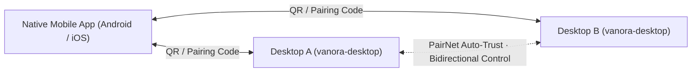
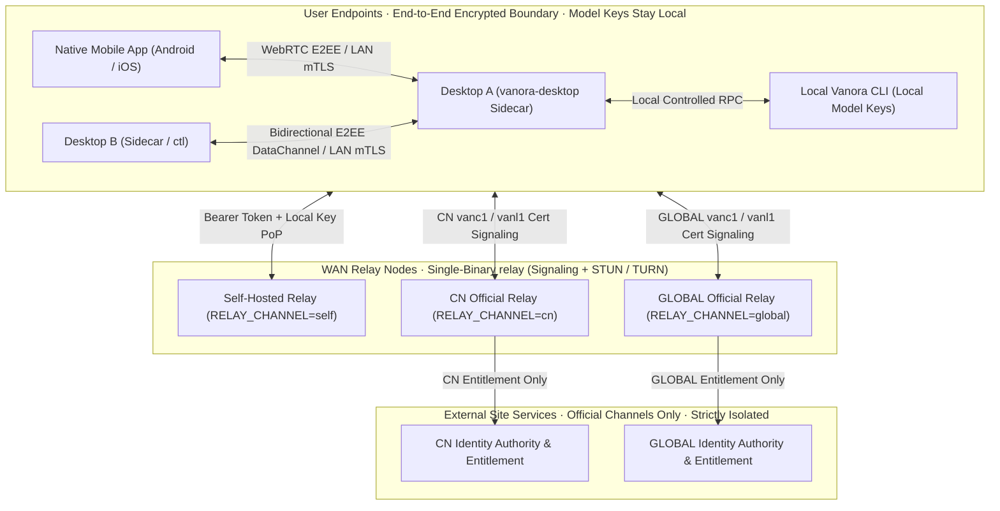

<div align="center">

# Vanora Relay

**Secure, low-latency, zero-custody end-to-end connectivity — control your local [Vanora](https://github.com/VANORA-Team/vanora) safely from mobile apps and other computers**

[](go.mod)
[](#architecture-overview)
[](#four-connection-channels)
[](#documentation-hub)

[简体中文](README.md) · **English**

[Key Features](#key-features) · [Channels](#four-connection-channels) · [Pairing Network](#pairing-network--pc-to-pc-control) · [Architecture](#architecture-overview) · [Quick Start](#quick-start) · [Security](#security--testing) · [Docs](#documentation-hub)

</div>

---

**Vanora Relay** brings remote, multi-device access to your locally running [Vanora](https://github.com/VANORA-Team/vanora). Whether you are monitoring and approving AI agent runs from a native mobile app or controlling one computer from another, **conversation payloads and model API keys stay strictly between your devices**—relay servers only coordinate signaling and forward encrypted ciphertext when NAT traversal requires TURN.

---

## Key Features

- **End-to-End Encrypted, Model Keys Never Leave Your Machine**
  Prompts, model reasoning, tool outputs, and approvals travel exclusively over encrypted WebRTC DataChannels (or LAN mutual-TLS WebSockets). Model API keys and provider sessions remain strictly inside your desktop's local Vanora config, fully decoupled from relay channels.
- **Four Isolated Connection Channels**
  Choose account-free **LAN direct (`lan`)**, account-free **Self-hosted relay (`self`)**, or strictly isolated **CN / GLOBAL official relays (`cn` / `global`)**. You can stay signed into multiple model providers locally while freely pairing them with any relay channel.
- **Scan-to-Join Pairing Network & Bidirectional PC-to-PC Control**
  Scan a QR code or enter a 16-character encrypted pairing code to join a decentralized Pairing Network (PairNet). Devices in the same network automatically synchronize membership for **Mobile ↔ Desktop** and **Desktop ↔ Desktop** control, while each desktop enforces its own local ACL independently.
- **Direct P2P First, Seamless TURN Fallback**
  Establishes peer-to-peer WebRTC links via STUN first, automatically falls back to TURN across restrictive NATs, and migrates back to direct links whenever available. Built-in support for network handoffs, sequence-based replay (`events.resume`), and `request_id` idempotency.
- **Fine-Grained Local ACL & Remote Tool Approval**
  A local `desktop.json` allowlist governs every exposed workspace, session, and tool. With `approval_policy: "remote"`, write or destructive tool calls pause for real-time approval over the encrypted channel, and revoking access immediately cancels affected guest runs.
- **Embeddable Sidecar & Native Mobile SDKs**
  Ships `vanora-desktop` (standalone CLI + hot-switching Sidecar process) alongside `gomobile`-built Android AAR and iOS XCFramework bindings integrated with native OS keystores (Keychain / AndroidKeyStore / Credential Manager).

---

## Four Connection Channels

Each channel maintains its own isolated credential vault, member roster, and desktop resource switch:

| Channel | Best For | Account Required | Transport & Authentication | Resource Gate |
| :--- | :--- | :---: | :--- | :--- |
| **LAN Direct (`lan`)** | Ultra-fast offline local network access | **None** | Private IP + mutual-TLS WebSocket + one-time pairing | `lan_access: true` |
| **Self-Hosted (`self`)** | Personal VPS or team-managed public relay | **None** | `RELAY_SELF_TOKEN` gate + local Ed25519 PoP + one-time HMAC pairing | `self_access: true` |
| **CN Official (`cn`)** | Public remote access on the CN site | CN account | CN site Ed25519 public key (`vanc1`/`vanl1`) + CN-only TURN entitlement | `owner` / `users` ACL |
| **GLOBAL Official (`global`)** | Public remote access on the GLOBAL site | GLOBAL account | GLOBAL site Ed25519 public key (`vanc1`/`vanl1`) + GLOBAL-only TURN entitlement | `owner` / `users` ACL |

> [!TIP]
> **Models and relays are completely decoupled**: you can run models from the CN provider locally on your desktop while connecting over a GLOBAL official relay or your own self-hosted node (or vice versa). The desktop Sidecar hot-switches the active WAN relay (`cn` / `global` / `self`) without restarting or interrupting running tasks or active `lan` sessions.

---

## Pairing Network & PC-to-PC Control

**Scan a QR code or type a 16-character encrypted code to join** (each one-time invitation expires in 5 minutes). Members in the same Pairing Network propagate roster updates over authenticated channels so devices automatically recognize one another:



- **Fail-Safe Reverse Permissions**: On `lan` and `self` channels, a desktop discovered transitively via PairNet defaults to **`read`** access only. Grant execution permissions either at pairing time (`grant_access: "control"`) or dynamically via `access.client.access.set`—no re-pairing required.
- **Instant Revocation Propagation**: Removing any member from the roster immediately cuts inbound and outbound links, terminates affected guest tasks, and propagates the revocation epoch to online peers.
- **Two Ways to Control Remote Desktops**: Use Sidecar `remote.*` JSONL commands inside a host app, or run `vanora-desktop ctl` directly from terminals and scripts.

---

## Architecture Overview



### Core Components & Security Boundaries

| Component | Responsibility | Security Boundary |
| :--- | :--- | :--- |
| **`relay`** (`cmd/relay`) | WebSocket signaling hub, encrypted pairing-box lookup, STUN config, and TURN ciphertext relay | **Never sees AI conversation plaintext**; official sites never cross-verify; self-hosted mode has zero external dependencies |
| **`vanora-desktop`** (`cmd/vanora-desktop`) | Hosts local Vanora RPC, enforces workspace/session/tool ACLs, and provides outbound remote control (`remote.*` & `ctl`) | Channel-isolated encrypted vaults (`account-cn.enc` / `account-global.enc` / `self.enc` / `lan.enc`) backed by OS keyrings |
| **`mobile` & `native`** | Wraps official dual-site, self-hosted pairing, and LAN clients for mobile apps | AndroidKeyStore (AES-GCM) / iOS Keychain storage, event cursor recovery, and concurrent multi-desktop handles |
| **External Identity Authority** *(official only)* | Validates host client auth tokens and mints short-lived `vanc1` certificates and `<= 60s` `vanl1` liveness leases | Signing private key is held externally and never shipped in this repository (see [Identity Contract](internal/identity/README.md)) |

---

## Quick Start

### Prerequisites

- **Go 1.26+** (default toolchain in `go.mod`: `go1.27.4`)
- A local [Vanora](https://github.com/VANORA-Team/vanora) installation (native binary or Node.js + `dist/cli.js`) for running `vanora-desktop`

### 1. Build & Run Tests

```sh
# Clone the repository
git clone https://github.com/VANORA-Team/Vanora-relay.git
cd Vanora-relay

# Build the relay server and desktop adapter binaries
go build ./cmd/...

# Run unit and end-to-end integration tests
go test ./...
```

<details>
<summary>Verify network-loss recovery against a real Vanora CLI</summary>

```sh
VANORA_TEST_CLI=/abs/path/to/vanora/packages/coding-agent/dist/cli.js \
  go test ./mobile -run TestUpstreamVanoraRunAfterNetworkLoss -count=1
```

</details>

### 2. Spin Up an Account-Free Self-Hosted Relay in 3 Minutes (`RELAY_CHANNEL=self`)

No official account or external backend required—launch your own signaling + STUN/TURN server directly:

```sh
# 1) Start a self-hosted relay (place behind Caddy/Nginx TLS reverse proxy in production)
export RELAY_CHANNEL=self
export RELAY_SELF_TOKEN="$(openssl rand -base64 32)"
export TURN_PUBLIC_IP="127.0.0.1" # Replace with your server's public IPv4 in production
export STUN_URLS="local"

./relay
```

```sh
# 2) Start the desktop adapter connected to your self-hosted relay (see docs/en/desktop.md for desktop.json)
./vanora-desktop serve \
  -channel self \
  -self-signal ws://127.0.0.1:8787/v1/signal \
  -self-token "$RELAY_SELF_TOKEN" \
  -config desktop.json \
  -name MyDesktop
```

Once online, write `{"type":"access.relay.invite.create"}` to `stdin` to generate a one-time QR code and 16-character pairing code for your mobile app or another computer (`vanora-desktop ctl pair`).

> [!NOTE]
> For production Linux `systemd`, Caddy / Nginx reverse proxy configs, and firewall rules, see the **[Server Deployment & Operations Guide](docs/en/deployment.md)**.

---

## Security & Testing

Vanora Relay is designed around a **Zero-Trust Relay** threat model: compromising the signaling server or membership backend does not allow an attacker to impersonate a paired desktop or bypass local ACL enforcement.

- **Signed Negotiation & Liveness Leases**: WebRTC DTLS fingerprints are Ed25519-signed together with endpoint identities, connection nonces, and negotiation rounds. Official channels additionally require exchanging `<= 60s` liveness leases inside the DataChannel, halting tool execution immediately upon authority loss.
- **Defense-in-Depth Quotas & SSRF Protection**: Signaling isolates pre-auth connection pools (`256` global / `16` per IP, HTTP `429`) from authenticated slots (`1024`). The TURN server allows globally routable unicast IPv4 peers only, blocks all local host interface IPs, and enforces per-visitor grant caps and atomic concurrent allocation quotas.
- **Reproducible Security Regression Suite**: Includes in-process protocol/ACL attack tests, 4 Go fuzz targets, and a Linux network-namespace lab with `ip_forward=0`.

```sh
# Run strict + heavy security regression checks
VANORA_SECURITY_STRICT=1 VANORA_SECURITY_HEAVY=1 go test ./... -count=1
```

Read the full threat model and verification steps in **[Security Model & Verification](docs/en/security.md)** and **[Security Test Suite README](test/security/README.md)**.

---

## Documentation Hub

Pick a guide by role, or browse the complete **[Documentation Hub](docs/en/README.md)**:

| Guide | Audience | Highlights |
| :--- | :--- | :--- |
| **[Server Deployment & Operations](docs/en/deployment.md)** | Ops / Self-Hosters | Channel selection, env matrix, account-free self-hosting (`systemd` / Caddy / Nginx), CN/GLOBAL isolation, rate limits & entitlement API |
| **[Desktop Adapter Guide](docs/en/desktop.md)** | Desktop Users / Integrators | `vanora-desktop` CLI, dual-site Sidecar hot-switching & JSONL commands, PC-to-PC control (`remote.*` & `ctl`), complete `desktop.json` ACL schema |
| **[Mobile SDK Integration](docs/en/mobile.md)** | Android / iOS Developers | AAR & XCFramework builds, 4-channel constructors & isolated stores, multi-desktop PairNet, Kotlin/ObjC examples & event-loop contract |
| **[Protocol & Custom Clients](docs/en/protocol.md)** | Protocol / Non-Go Authors | Official & self-hosted sequence diagrams, AES-GCM pairing codes, PairNet epoch sync, Ed25519 wire signing, DataChannel framing & RPC |
| **[Security Model & Verification](docs/en/security.md)** | Security Reviewers | Zero-trust boundaries, cryptography, signaling/TURN quotas, strict security tests, fuzzing & Linux netns labs |

**Architecture & Low-Level Specs**: [Architecture Design & Acceptance](docs/en/design.md) · [External Identity Contract](internal/identity/README.md) · [STUN / TURN Internals & Byte Accounting](internal/ice/README.md) · [Security Test Suite (zh-CN)](test/security/README.md)

---

## Repository Structure

<details>
<summary>Expand full directory layout</summary>

| Path | Description |
| :--- | :--- |
| `cmd/relay` | Unified signaling hub and STUN/TURN server binary |
| `cmd/vanora-desktop` | Desktop adapter CLI, multi-channel hot-switching Sidecar, and remote controller (`login` / `serve` / `ctl` / `whoami` / `status` / `logout`) |
| `adapter/account` | Official-channel endpoint keys, cert/lease renewal, and per-site vault management |
| `adapter/desktop` | Local Vanora RPC supervisor, persisted session state, ACL enforcement, and built-in approval guard (`guard/`) |
| `adapter/lan` | Local-network mutual-TLS WebSocket server and client |
| `adapter/selfrelay` | Account-free self-hosted pairing server, HMAC handshake, and client |
| `adapter/transport` | Official-channel signaling transport, WebRTC wrapper, and message chunking |
| `adapter/remote` | Outbound controller enabling a desktop to manage multiple remote desktops concurrently |
| `internal/signal` | WebSocket signaling hub (official single-site & self-hosted modes), pre-auth rate limiting, and connection routing |
| `internal/ice` | `pion/turn/v4` STUN/TURN server, grant lifecycle, quotas, and deduplicated byte accounting |
| `internal/identity` | Offline `vanc1`/`vanl1` verifier, client PoP signing helpers, and self-hosted device ID derivation |
| `internal/membership` | Single-site external entitlement HTTP client |
| `internal/pairing` | Cross-channel invitation link parser, QR renderer, and AES-256-GCM 16-char pairing codes |
| `internal/pairnet` | Decentralized pairing-network roster, epoch merge, and revocation propagation |
| `protocol` | Signaling wire format and Ed25519 sign/verify primitives |
| `endpoint` | Official certificate verification, signed device cards, negotiated WebRTC sealing, and lease access control |
| `mobile` | `gomobile`-compatible Go SDK for Android and iOS |
| `native/` | Android AAR build script + AndroidKeyStore wrapper, iOS Keychain wrapper |
| `test/` | Linux netns E2E relay lab (`relaye2e/`) and security regression / fuzzing suite (`security/`) |
| `docs/` | Bilingual documentation (`docs/` for Simplified Chinese, `docs/en/` for English) |

</details>
