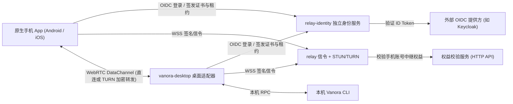

# Vanora Relay

让原生手机 App 通过 WebRTC 安全连接本机电脑上的 [Vanora](https://github.com/VANORA-Team/vanora)。

- **模型密钥不上云**：模型 API Key 仅保留在本地电脑的 Vanora 配置中，无需进入 `relay` 或 `relay-identity`。
- **独立身份信任根**：端点签名私钥仅由 `relay-identity` 持有，信令与权益服务均无法伪造端点身份。
- **直连优先、按需中继**：优先通过 STUN 建立端到端直连，具备中继权益时自动支持 TURN 转发；AI 对话正文只在两端加密 DataChannel 内流转。

---

## 架构概览



| 组件 | 职责 | 安全边界与说明 |
| --- | --- | --- |
| `relay-identity` | 对接外部 OIDC 提供方，为端点公钥签发短期证书与活性租约 | 独立部署，**唯一持有**端点签名私钥的组件 |
| `relay` | 设备发现、签名信令路由、STUN 及按权益授权的 TURN | 仅持身份服务公钥，无签名私钥，不接触 AI 对话正文 |
| `vanora-desktop` | 启动并托管本机 Vanora RPC 进程、执行会话与工具 ACL | 端点私钥存于系统凭据库；支持独立运行与 Sidecar 内嵌 |
| `mobile` / `native` | 封装登录、信令、WebRTC 传输与会话恢复状态机 | 提供 Android AAR 与 iOS XCFramework 原生绑定 |

---

## 文档导航

详细部署、配置、接入与协议说明已整理至 [`docs/`](docs/README.md)：

| 文档 | 内容说明 |
| --- | --- |
| [服务端部署与权益校验](docs/deployment.md) | 密钥生成、`relay-identity`（OIDC）与 `relay`（信令 / STUN / TURN）部署、运维探针及 TURN 权益校验 HTTP 接口 |
| [桌面适配器指南](docs/desktop.md) | `vanora-desktop` 登录与账号管理、Sidecar 内嵌模式、`desktop.json` 会话/工作区/权限/远程审批配置 |
| [移动端 SDK 接入指南](docs/mobile.md) | Android AAR / iOS XCFramework 构建、原生接入示例及事件循环与断点续读约定 |
| [协议与自定义客户端参考](docs/protocol.md) | 端点接入时序、非 Go 客户端 Ed25519 签名规范、DataChannel 分片帧与业务协议 / 错误码 |

**模块与设计文档**：[架构设计与验收场景](DESIGN.md) · [身份服务协议与配置](internal/identity/README.md) · [STUN / TURN 详细配置](internal/ice/README.md)

---

## 快速开始与测试

需要 **Go 1.25** 或更高版本：

```sh
# 构建全部服务端与桌面端二进制
go build ./cmd/...

# 运行单元与端到端集成测试（信令、WebRTC、身份服务、STUN/TURN 与两端适配器）
go test ./...
```

如需驱动真实 Vanora CLI 验证断线续跑、事件补发与 `request_id` 去重（测试中的模型响应由本机 HTTP 测试服务模拟）：

```sh
VANORA_TEST_CLI=/abs/path/to/vanora/packages/coding-agent/dist/cli.js \
  go test ./mobile -run TestUpstreamVanoraRunAfterNetworkLoss -count=1
```

> [!NOTE]
> 公网 NAT 穿透兼容性需在部署到公网可达节点后，使用真实手机蜂窝网络与家庭网络进行验收。

---

## 目录结构

| 路径 | 说明 |
| --- | --- |
| `docs/` | 部署、桌面端、移动端与协议详细文档 |
| `cmd/relay-identity` | 独立身份签发服务 CLI（`keygen`、`serve`） |
| `cmd/relay` | 信令与 STUN/TURN 统一服务端进程 |
| `cmd/vanora-desktop` | 桌面端适配器 CLI（`login`、`serve`、`whoami`、`logout`） |
| `internal/identity` | OIDC 验证、证书 / 租约签发与刷新句柄实现 |
| `internal/signal` | WebSocket 信令集线器、设备目录与连接路由 |
| `internal/ice` | STUN/TURN 服务端、grant 生命周期与流量计数 |
| `internal/membership` | 外部权益校验 HTTP 客户端 |
| `protocol` | 信令消息格式与 Ed25519 签名 / 验签 |
| `endpoint` | 端点证书校验、设备卡验证、签名协商与租约访问控制 |
| `adapter/` | 账号管理（`account`）、WebRTC 传输与分片（`transport`）、桌面业务适配器（`desktop`） |
| `mobile` | 面向 `gomobile` 绑定的移动端 Go SDK |
| `native/` | Android AAR 构建脚本与 Keystore 封装、iOS Keychain 封装 |
