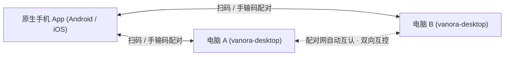
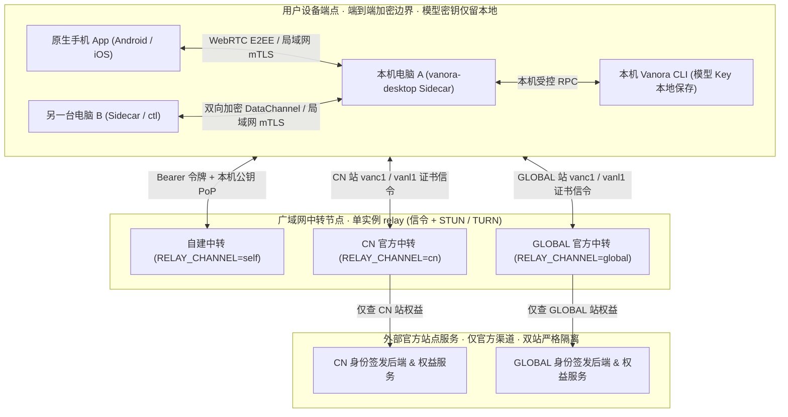

<div align="center">

# Vanora Relay

**安全、低延迟、零托管密钥的端到端远程连接层 —— 让手机与其他电脑安全操控本机 [Vanora](https://github.com/VANORA-Team/vanora)**

[](go.mod)
[](#架构概览)
[](#四种连接通道)
[](#文档中心)

**简体中文** · [English](README.en.md)

[核心特性](#核心特性) · [四种连接通道](#四种连接通道) · [配对网与电脑互控](#配对网与电脑互控) · [架构概览](#架构概览) · [快速开始](#快速开始) · [安全与测试](#安全与测试) · [文档中心](#文档中心)

</div>

---

**Vanora Relay** 为本机运行的 [Vanora](https://github.com/VANORA-Team/vanora) 提供跨设备远程接入能力。无论是用原生手机 App 随时查看与审批 AI 任务，还是在多台电脑之间双向互控，**对话正文与模型密钥始终留在你的设备之间**——中转节点只负责信令路由与必要的密文转发。

---

## 核心特性

- **端到端加密，模型密钥永不上云**
  AI 对话正文、思考过程与工具输出只在两端加密的 WebRTC DataChannel（或局域网 mTLS）中流转。模型 API Key 与供应商登录态始终留在电脑本地，与远程中转通道完全解耦。
- **四种隔离通道，按需自由选择**
  支持免账号的 **局域网直连（LAN）** 与 **自建中转（Self）**，也支持严格分站隔离的 **CN / GLOBAL 官方中转**。本机可同时登录多个模型供应商，按需交叉组合不同中转通道。
- **一次扫码组网，手机与电脑双向互控**
  扫描二维码或输入 16 位加密手输码即可加入设备配对网（PairNet）。同一网络内支持 **手机 ↔ 电脑** 与 **电脑 ↔ 电脑** 双向互认与并发控制，同时每台电脑独立执行本机 ACL 权限。
- **直连优先，按需 TURN 中继**
  优先通过 STUN 建立 P2P 直连；在复杂 NAT 环境下自动无缝切换至 TURN 转发，并在直连恢复后优先迁移。支持移动切网重连、事件序号游标补发（`events.resume`）与 `request_id` 幂等去重。
- **细粒度本地授权与远程审批**
  通过本机 `desktop.json` 白名单严格控制暴露的工作区、会话与本地工具集；开启 `approval_policy: "remote"` 后，写入或破坏性工具操作会经加密通道推送到手机/控制端实时确认，支持随时撤权并立即取消运行中的访客任务。
- **嵌入式 Sidecar 与原生移动 SDK**
  提供 `vanora-desktop` 独立 CLI / 热切换 Sidecar 二进制，以及基于 `gomobile` 构建的 Android AAR 与 iOS XCFramework，开箱即接入原生系统密钥库（Keychain / Keystore / Credential Manager）。

---

## 四种连接通道

四种通道各自维护独立的密钥槽位、成员名单与资源暴露开关，互不串扰：

| 通道 | 适用场景 | 账号要求 | 传输与鉴权方式 | 资源访问开关 |
| :--- | :--- | :--- | :--- | :--- |
| **局域网直连 (`lan`)** | 同 Wi-Fi / 内网极速免外网互联 | **免账号** | 私有 IP + 双向 mTLS WebSocket + 一次性配对 | `lan_access: true` |
| **自建中转 (`self`)** | 个人 VPS / 团队自建公网节点 | **免账号** | `RELAY_SELF_TOKEN` 门禁 + 本机 Ed25519 PoP + 一次性 HMAC 配对 | `self_access: true` |
| **CN 官方中转 (`cn`)** | 登录 CN 站的公网远程互联 | 登录 CN 站 | CN 站独立身份公钥 (`vanc1`/`vanl1`) + 仅查 CN 站 TURN 权益 | `owner` / `users` ACL |
| **GLOBAL 官方中转 (`global`)** | 登录 GLOBAL 站的公网远程互联 | 登录 GLOBAL 站 | GLOBAL 站独立身份公钥 (`vanc1`/`vanl1`) + 仅查 GLOBAL 站 TURN 权益 | `owner` / `users` ACL |

> [!TIP]
> **模型与中转完全解耦**：你可以在本机 Vanora 中使用 CN 站模型，同时走拥有权益的 GLOBAL 官方中转或自建中转（反之亦然）。桌面 Sidecar 支持在不重启进程、不中断本地任务的前提下，对广域网通道（`cn` / `global` / `self`）热切换，并可与 `lan` 并发运行。

---

## 配对网与电脑互控

**扫码或输入 16 位加密配对码即可入网**（每份邀请有效 5 分钟，单次兑换生效）。同一配对网内的设备会自动经认证通道同步成员列表并建立互认，无需逐对重复扫码：



- **默认安全（Fail-Safe）反向权限**：在 `lan` 与 `self` 渠道下，经配对网间接发现或反向接入的电脑默认仅获 **`read`** 权限；需要远程执行任务时，可在配对时显式传 `grant_access: "control"`，或随时通过 `access.client.access.set` 动态切换权限，无需重新配对。
- **即时撤权同步**：在任意成员列表中移除设备后，本地立即切断双向连接并终止其受影响任务，撤销代数（`epoch`）自动向在线成员广播同步。
- **两种电脑控机方式**：嵌入宿主时通过 Sidecar `remote.*` JSONL 指令并发控机；终端或自动化脚本可直接使用 `vanora-desktop ctl` 子命令。

---

## 架构概览



### 核心组件与安全边界

| 组件 | 核心职责 | 安全边界 |
| :--- | :--- | :--- |
| **`relay`** (`cmd/relay`) | WebSocket 信令路由、配对密文寄存、STUN 下发与 TURN 密文转发 | **不接触 AI 对话正文**；官方渠道双站绝不互通；自建渠道零外部账号依赖 |
| **`vanora-desktop`** (`cmd/vanora-desktop`) | 托管本机 Vanora RPC、执行工作区/会话/工具 ACL，内置远程控机端 (`remote.*` & `ctl`) | 凭据按渠道分槽加密存储（`account-cn.enc` / `account-global.enc` / `self.enc` / `lan.enc`），密钥存系统密钥库 |
| **`mobile` & `native`** | 封装官方双站、自建配对与局域网客户端，提供原生移动绑定 | AndroidKeyStore (AES-GCM) / iOS Keychain 隔离存储，支持事件游标恢复与多电脑并发 |
| **外部身份后端** *(仅官方渠道)* | 校验宿主客户端登录态，为设备公钥签发短期 `vanc1` 证书与 `<= 60s` `vanl1` 租约 | 签名私钥闭源独立部署，信令与权益服务均无法伪造端点身份（详见 [身份协议规范](internal/identity/README.md)） |

---

## 快速开始

### 环境要求

- **Go 1.26+**（仓库默认工具链为 `go1.27.4`）
- 桌面端运行需本机安装 [Vanora](https://github.com/VANORA-Team/vanora)（原生二进制或 Node.js + `dist/cli.js`）

### 1. 构建与本地测试

```sh
# 克隆仓库
git clone https://github.com/VANORA-Team/Vanora-relay.git
cd Vanora-relay

# 构建服务端 (relay) 与桌面端适配器 (vanora-desktop)
go build ./cmd/...

# 运行全量单元测试与端到端集成测试
go test ./...
```

<details>
<summary>使用真实 Vanora CLI 验证断线续跑与事件补发</summary>

```sh
VANORA_TEST_CLI=/abs/path/to/vanora/packages/coding-agent/dist/cli.js \
  go test ./mobile -run TestUpstreamVanoraRunAfterNetworkLoss -count=1
```

</details>

### 2. 3 分钟体验免账号自建节点（`RELAY_CHANNEL=self`）

无需任何官方账号或外部依赖，一条命令即可拉起你自己的信令 + STUN/TURN 节点：

```sh
# 1) 启动本地/自建中转节点（生产环境请置于 Caddy/Nginx TLS 反代之后）
export RELAY_CHANNEL=self
export RELAY_SELF_TOKEN="$(openssl rand -base64 32)"
export TURN_PUBLIC_IP="127.0.0.1" # 公网部署替换为服务器公网 IPv4
export STUN_URLS="local"

./relay
```

```sh
# 2) 在电脑端启动桌面适配器并接入自建节点（desktop.json 示例见 docs/desktop.md）
./vanora-desktop serve \
  -channel self \
  -self-signal ws://127.0.0.1:8787/v1/signal \
  -self-token "$RELAY_SELF_TOKEN" \
  -config desktop.json \
  -name MyDesktop
```

上线后在标准输入发送 `{"type":"access.relay.invite.create"}`，即可获得一次性二维码与 16 位配对码，供手机 App 或另一台电脑（`vanora-desktop ctl pair`）扫码接入。

> [!NOTE]
> 完整生产级 systemd、Caddy / Nginx 反向代理与防火墙配置，请查看 **[服务端部署与运维指南](docs/deployment.md)**。

---

## 安全与测试

Vanora Relay 以**零信任中转**为设计前提：即使信令服务器或会员站遭到入侵，也无法伪造已绑定的电脑身份或绕过本机 ACL。

- **双重加密验证**：WebRTC DTLS 指纹与端点 Ed25519 公钥、连接随机数、协商轮次强绑定；官方渠道额外要求 DataChannel 首帧及周期交换 `<= 60s` 活性租约，失联后工具执行权限立即停止。
- **纵深限流与防穿透**：信令层分离预认证槽位池（防未认证连接耗尽）与已认证连接池；TURN 服务端内置全局单播白名单并屏蔽宿主机本机接口 IP、强制每访客 Grant 配额与并发 Allocation 原子配额。
- **可复现安全回归套件**：内置进程内安全攻击测试、4 组 Go 原生模糊测试（Fuzzing）与基于 Linux 网络命名空间的无外网隔离靶场。

```sh
# 运行严格 + 高压力安全回归门禁
VANORA_SECURITY_STRICT=1 VANORA_SECURITY_HEAVY=1 go test ./... -count=1
```

完整威胁模型、防护机制与靶场复测指南见 **[安全模型与验证指南](docs/security.md)** 与 **[安全测试套件说明](test/security/README.md)**。

---

## 文档中心

按你的使用角色选择对应文档，或直接浏览 **[完整文档目录](docs/README.md)**：

| 文档 | 适用对象 | 核心内容 |
| :--- | :--- | :--- |
| **[服务端部署与运维](docs/deployment.md)** | 运维 / 自建部署者 | 渠道模式选择、环境变量矩阵、免账号自建部署（systemd / Caddy / Nginx）、CN/GLOBAL 单站隔离与权益接口 |
| **[桌面适配器指南](docs/desktop.md)** | 桌面用户 / 宿主集成者 | `vanora-desktop` CLI、Sidecar 双站热切换与 JSONL 指令、电脑互控 (`remote.*` & `ctl`)、`desktop.json` ACL 完整规范 |
| **[移动端 SDK 接入](docs/mobile.md)** | Android / iOS 开发者 | AAR / XCFramework 构建、四通道客户端构造与存储隔离、配对网多电脑并发、Kotlin / iOS 接入示例与事件循环 |
| **[协议与自定义客户端](docs/protocol.md)** | 协议研发 / 非 Go 客户端 | 官方与自建接入时序图、16 位手输码加密规范、PairNet 成员同步、Ed25519 签名、DataChannel 分片帧与业务 RPC |
| **[安全模型与验证](docs/security.md)** | 安全审计 / 架构评估 | 信任边界、密钥与租约体系、中转限流与 TURN 防护、严格安全测试与 Linux 隔离靶场 |

**延伸模块规范**：[架构设计与验收场景](DESIGN.md) · [外部身份签发与验签规范 (EN)](internal/identity/README.md) · [STUN / TURN 内核与流量统计 (EN)](internal/ice/README.md) · [安全测试套件说明](test/security/README.md)

---

## 目录结构

<details>
<summary>展开查看完整仓库目录说明</summary>

| 路径 | 说明 |
| :--- | :--- |
| `cmd/relay` | 信令集线器与 STUN/TURN 统一服务端进程 |
| `cmd/vanora-desktop` | 桌面端适配器 CLI、多渠道热切换 Sidecar 与远程控机命令行 (`login` / `serve` / `ctl` / `whoami` / `status` / `logout`) |
| `adapter/account` | 官方渠道设备密钥、证书/租约续期与分槽凭据管理 |
| `adapter/desktop` | 本机 Vanora RPC 进程托管、会话状态、ACL 鉴权与内置审批守卫扩展 (`guard/`) |
| `adapter/lan` | 局域网 mTLS WebSocket 服务端与客户端 |
| `adapter/selfrelay` | 免账号自建中转配对服务端、HMAC 握手与客户端 |
| `adapter/transport` | 官方渠道信令传输、WebRTC 封装与消息分片 |
| `adapter/remote` | 桌面端并发控制多台远程电脑的出站控制器 |
| `internal/signal` | WebSocket 信令集线器（官方单站与自建免账号模式）、预认证限流与连接路由 |
| `internal/ice` | 基于 `pion/turn/v4` 的 STUN/TURN 服务端、Grant 生命周期、配额与字节统计 |
| `internal/identity` | `vanc1`/`vanl1` 离线验签、PoP 签名辅助与自建设备标识派生 |
| `internal/membership` | 官方单站外部权益校验 HTTP 客户端 |
| `internal/pairing` | 跨渠道一次性邀请链接解析、二维码渲染与 AES-256-GCM 16 位手输码 |
| `internal/pairnet` | 去中心化设备配对网成员管理、Epoch 版本合并与撤销同步 |
| `protocol` | 信令消息线格式与 Ed25519 签名 / 验签 |
| `endpoint` | 官方端点证书校验、设备卡验证、签名协商与租约访问控制 |
| `mobile` | 面向 `gomobile` 绑定的移动端 Go SDK |
| `native/` | Android AAR 构建脚本与 Keystore 封装、iOS Keychain 封装 |
| `test/` | Linux 网络命名空间生产路径端到端靶场 (`relaye2e/`) 与安全测试/模糊测试套件 (`security/`) |
| `docs/` | 面向部署者、开发者与协议实现者的完整文档集 |

</details>
