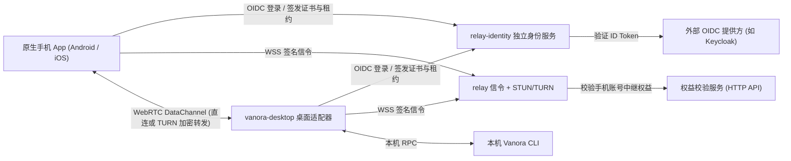

# Vanora Relay

让原生手机 App 通过 WebRTC 安全连接本机电脑上的 [Vanora](https://github.com/VANORA-Team/vanora)。

本仓库包含四个核心部分：独立身份签发服务（`relay-identity`）、信令与 STUN/TURN 中继服务（`relay`）、桌面端适配器（`vanora-desktop`），以及面向 Android / iOS 的移动端原生 SDK（`mobile` / `native`）。

- **模型密钥不上云**：模型 API Key 仅保留在本地电脑的 Vanora 配置中，无需进入 `relay` 或 `relay-identity`。
- **独立身份信任根**：端点签名私钥仅由 `relay-identity` 持有，信令与权益服务均无法伪造端点身份。
- **直连优先、按需中继**：优先通过 STUN 建立端到端直连，具备中继权益时自动支持 TURN 转发；AI 对话正文只在两端加密 DataChannel 内流转。

> **快速导航**
> [架构概览](#架构概览) · [部署服务端](#部署服务端) · [权益校验接口](#权益校验接口turn-授权) · [运行桌面适配器](#运行桌面适配器) · [接入手机应用](#接入手机应用) · [协议与接入参考](#协议与接入参考) · [测试与验证](#测试与验证) · [目录结构](#目录结构)

---

## 架构概览



| 组件 | 职责 | 安全边界与说明 |
| --- | --- | --- |
| `relay-identity` | 对接外部 OIDC 提供方，为端点公钥签发短期证书与活性租约 | 独立部署，**唯一持有**端点签名私钥的组件 |
| `relay` | 设备发现、签名信令路由、STUN 及按权益授权的 TURN | 仅持身份服务公钥，无签名私钥，不接触 AI 对话正文 |
| `vanora-desktop` | 启动并托管本机 Vanora RPC 进程、执行会话与工具 ACL | 端点私钥存于系统凭据库；模型凭据沿用本机 Vanora 配置 |
| `mobile` / `native` | 封装登录、信令、WebRTC 传输与会话恢复状态机 | 提供 Android AAR 与 iOS XCFramework 绑定 |

更多设计细节：[架构设计与验收场景](DESIGN.md) · [身份协议与配置](internal/identity/README.md) · [STUN / TURN 详细配置](internal/ice/README.md)

---

## 部署服务端

需要 **Go 1.25** 或更高版本。`relay-identity` 与 `relay` 可独立部署，以下均为 Bash 示例。

### 1. 构建并生成身份签名密钥

```sh
go build ./cmd/...
go run ./cmd/relay-identity keygen -out identity-signing-key -public-out identity-signing-key.pub
```

> [!IMPORTANT]
> 私钥（`identity-signing-key`）只保存在独立部署的 `relay-identity` 主机上（权限 `0600`），不要分发给信令、权益后端或客户端；仅将公钥（`identity-signing-key.pub`）分发给 `relay` 与各端点。

### 2. 配置 OIDC 并启动 `relay-identity`

`relay-identity` 支持任意符合标准 Discovery / JWKS 规范的 OIDC 提供方（如 Keycloak），配置需满足：

- 单独注册一个原生应用 Client：启用 **Authorization Code（Standard Flow）** 与 **PKCE S256**，登记精确回调地址，并允许 `openid offline_access`。
- 若配合外部权益服务校验中继权限，`VANORA_IDENTITY_OIDC_ISSUER` 须与权益服务使用的完整 issuer URL（例如 Keycloak 的完整 realm URL）一致，且同一账号在两个端应返回相同的 `sub`。
- 端点在系统浏览器中完成登录；电脑端无人值守自动续期要求 OIDC 的 refresh grant 返回可验证的 ID token（如提供方不支持，可设置 `VANORA_IDENTITY_DISABLE_REFRESH=1`，证书过期后需重新登录）。

```sh
export VANORA_IDENTITY_SIGNING_KEY_FILE=identity-signing-key
export VANORA_IDENTITY_OIDC_ISSUER=https://auth.example.com/realms/vanora
export VANORA_IDENTITY_OIDC_CLIENT_ID=vanora-native
export VANORA_IDENTITY_OIDC_REDIRECT_URI=com.vanora.app:/oauth/callback
export VANORA_IDENTITY_OIDC_REDIRECT_URIS=http://127.0.0.1/oauth/callback

go run ./cmd/relay-identity serve
```

> [!TIP]
> 同时配置 `VANORA_IDENTITY_OIDC_REDIRECT_URI`（手机自定义 Scheme）与 `VANORA_IDENTITY_OIDC_REDIRECT_URIS`（如 `http://127.0.0.1/oauth/callback`，不写端口即按 RFC 8252 自动匹配桌面临时回环端口），即可让手机和电脑 Sidecar 都自动完成浏览器回调登录，无需手动复制回调链接。

全部环境变量（监听地址、TLS、证书 / 挑战 / 租约 TTL 等）见 [internal/identity/README.md](internal/identity/README.md)。

### 3. 启动 `relay`（信令 + STUN / TURN）

| 环境变量 | 必填 | 默认值 | 说明 |
| --- | --- | --- | --- |
| `RELAY_IDENTITY_PUBLIC_KEY` | 是 | — | `relay-identity keygen` 生成的 Ed25519 公钥（hex） |
| `RELAY_MEMBERSHIP_URL` | 是 | — | 权益校验后端地址（生产须 HTTPS，本地开发允许回环 HTTP） |
| `RELAY_MEMBERSHIP_TOKEN` | 是 | — | 调用权益接口的随机服务密钥（至少 32 字节，不可含空白字符） |
| `TURN_PUBLIC_IP` | 是 | — | 本机或 NAT 对外公布的可达 IPv4（本地开发可用 `127.0.0.1`） |
| `RELAY_ADDR` | 否 | `127.0.0.1:8787` | 信令监听地址；非回环监听须配置 TLS |
| `RELAY_TLS_CERT` / `RELAY_TLS_KEY` | 否 | — | 信令直接启用 TLS 时的证书与私钥（成对设置） |

> [!NOTE]
> `RELAY_MEMBERSHIP_URL` 指向的权益路由属于内部服务接口，跨主机部署时建议通过私有网络与 HTTPS 入口暴露。完整 `TURN_*` 配置（端口范围、绑定网卡、并发上限等）见 [internal/ice/README.md](internal/ice/README.md)。

```sh
export RELAY_IDENTITY_PUBLIC_KEY="$(cat identity-signing-key.pub)"
export RELAY_MEMBERSHIP_URL=https://entitlement.internal.example.com
export RELAY_MEMBERSHIP_TOKEN="<至少32字节的随机服务密钥>"
export TURN_PUBLIC_IP=127.0.0.1

go run ./cmd/relay
```

### 4. 端口、探针与运维说明

| 服务 | 默认监听 | 健康探针 | 部署与防火墙要求 |
| --- | --- | --- | --- |
| 信令（`relay`） | `127.0.0.1:8787` | `GET /healthz` | 经反代暴露 HTTPS 并支持 `/v1/signal` WebSocket 升级，或设置 `RELAY_ADDR`、`RELAY_TLS_CERT`、`RELAY_TLS_KEY` 直接监听 TLS |
| 身份（`relay-identity`） | `127.0.0.1:8090` | `GET /readyz` | 独立发布权限与 TLS；`/readyz` 检查外部 IdP discovery 与 JWKS 可达性；客户端经 HTTPS 调用 `/v1/identity/*` |
| STUN / TURN（`relay`） | `0.0.0.0:3478`（UDP / TCP） | — | 放行 `TURN_PORT`（UDP + TCP）及 `TURN_RELAY_MIN_PORT`–`TURN_RELAY_MAX_PORT` UDP 端口（默认 `49152–65535`）；NAT 需保持公告端口映射；可按需设置 `TURN_BIND_IP`、`TURN_RELAY_BIND_IP` |

**运行时行为与限制：**

- **单实例、单区域**：首版不跨节点同步状态；重启信令或 TURN 后，端点会自动重新上线并重新协商连接。
- **流量统计日志**：访问者的中继字节数在 grant 结束时输出到服务日志，如需留存历史账单请在部署侧收集日志。
- **实时断流**：中继权益到期或被撤权时，服务端会立即关闭对应活跃的 relay socket。
- **目标地址过滤**：公网部署默认拒绝私网、回环、保留段等非公网单播目标 IP。
- **受限网络说明**：TURN 支持 UDP / TCP 控制传输与 UDP relay；仅放行 HTTPS 的网络环境仍可能无法连通。

---

## 权益校验接口（TURN 授权）

`relay` 不内置订阅数据库，而是通过一个简单的 HTTP 内部接口向外部权益服务（可对接自建后端或会员系统）查询**发起访问的手机账号**是否允许使用 TURN 中继。

```http
POST /internal/v1/relay/entitlement
Authorization: Bearer <RELAY_MEMBERSHIP_TOKEN>
Content-Type: application/json
```

> 若 `RELAY_MEMBERSHIP_URL` 未以 `/internal/v1/relay/entitlement` 结尾，客户端会自动拼接该路径；请求不跟随 HTTP 重定向。

**请求体：**

```json
{
  "issuer": "https://auth.example.com/realms/vanora",
  "subject": "<OIDC sub>"
}
```

**响应体：**

```json
{
  "success": true,
  "data": {
    "relay_allowed": true,
    "valid_until": 1767225600
  }
}
```

`valid_until` 为权益截止的 Unix 秒级时间戳。实现与对接时须遵循以下约定：

- **按访问者判权**：查询身份始终是发起连接的手机账号，电脑主人的中继权益不能替访客解锁 TURN。
- **身份一致性**：权益后端按 `(issuer, subject)` 定位已绑定账号；请使用同一测试账号验证原生端与账户系统拿到的 `sub` 一致。
- **显式授权**：建议由套餐或订阅状态显式控制 `relay_allowed`（默认关闭）。
- **失败降级（Fail-Closed）**：只有返回 `success: true`、`relay_allowed: true` 且 `valid_until` 在未来时才会下发 TURN 凭证；账号未绑定、已停用、请求超时或接口报错均自动降级为仅 STUN。
- **有效期叠加**：单次连接的 TURN 授权同时受端点证书有效期约束；权益服务不持有端点签名私钥。

---

## 运行桌面适配器

### 1. 构建与登录

```sh
go build -o vanora-desktop ./cmd/vanora-desktop
./vanora-desktop login \
  -identity https://identity.example.com \
  -ca identity-signing-key.pub \
  -redirect-uri http://127.0.0.1:0/oauth/callback
```

- **Windows**：可将产物名设为 `vanora-desktop.exe`。
- **无感回调登录**：传入 `-redirect-uri http://127.0.0.1:0/oauth/callback` 会自动绑定本机临时回环端口并接收 `code` 和 `state`；配置为自定义 URI Scheme 时按提示粘贴回调地址。传 `-no-browser -json` 可交由宿主 UI 展示/打开登录链接。
- **账号管理子命令**：支持 `whoami` / `status`（查看当前 `enrolled`、`user_id`、`device_id`）与 `logout`（安全重置本地设备密钥与绑定）。
- **Sidecar 内嵌模式**：将 `vanora-desktop` 作为子进程嵌入 Vanora 时，可在构建期用 `-ldflags "-X main.defaultIdentityURL=... -X main.defaultSignalURL=... -X main.defaultCAHex=..."` 注入默认服务配置（运行时仍可用 `-identity` / `-signal` / `-ca` / `-ca-hex` 或环境变量覆盖）；以 `serve -sidecar` 启动后会向 `stdout` 输出 JSON-lines 状态事件（`ready`、`online`、`offline`、`peer.connected`、`session.created`、`ui.request`、`shutdown` 等），支持通过 `stdin` 发送 `{"type":"reload"|"status"|"shutdown"}`，并在父进程退出（`stdin` EOF）时自动干净退出。
- **凭据与状态目录**：可通过 `-state-dir` 指定配置档目录，默认位于当前用户配置目录下的 `Vanora/relay`。端点私钥保存在系统凭据库中，运行 `serve` 时须使用同一桌面用户身份。

### 2. 编写会话与工作区配置（`desktop.json`）

`sessions` 与 `workspaces` 均可按需配置（允许 `0` 个预置会话启动，配合 `workspaces` 由手机远程新建会话）。所有路径须为本机真实**绝对路径**（Windows 可使用正斜杠 `/`）：

```json
{
  "executable": "node",
  "launcher_args": ["/abs/path/to/vanora/packages/coding-agent/dist/cli.js"],
  "workspaces": [
    {
      "id": "project",
      "title": "项目工作区",
      "working_dir": "/abs/path/to/project",
      "owner": "本机登录输出的 user_id",
      "tools": ["read", "edit", "write", "bash", "ask"],
      "show_thinking": true,
      "show_tools": true,
      "approval_policy": "remote"
    }
  ],
  "sessions": [
    {
      "id": "existing",
      "title": "已有对话",
      "working_dir": "/abs/path/to/project",
      "session_file": "/abs/path/to/sessions/project.jsonl",
      "owner": "本机登录输出的 user_id",
      "tools": ["read", "bash"],
      "show_thinking": true,
      "show_tools": true,
      "approval_policy": "remote",
      "users": [
        { "user_id": "访客手机登录后的 user_id", "read": true, "tools": false }
      ]
    }
  ]
}
```

**字段与权限说明：**

- **`executable` / `launcher_args`**：直接运行本机 Vanora 可执行文件时，仅填 `executable` 并省略 `launcher_args`；通过 Node 启动 `dist/cli.js` 时按上方示例配置。
- **`workspaces`**：远程新建会话的白名单工作目录。手机端只能选择已授权的 `workspace_id`，无法传入任意本机路径；默认按 Vanora 原生目录 `~/.vanora/agent/sessions/--<path>--/` 写入 v3 JSONL 会话文件（与终端 `vanora --resume` 直接互通），也可通过 `session_dir` 覆盖。
- **`working_dir` / `session_file`**：均须为绝对路径，且 `working_dir` 必须与会话 JSONL 首行记录的 `cwd` 一致。
- **`owner`**：填写 `login` 输出的 `user_id`；同账号手机自动享有主人权限。
- **`users`**：显式授权的访客列表。`read: true` 允许读取文本消息；`tools: true` 允许提交提示词（需同时开启 `read`）；访客默认**不**可见思考过程、工具调用详情与审批弹窗，除非显式设置 `show_thinking` / `show_tools` / `approve`。
- **`tools`**：决定本机 Vanora 实际启用的本地工具白名单；空数组 `[]` 表示运行纯文本对话。
- **`show_thinking` / `show_tools`**：是否向主人展示模型思考过程及工具调用/执行输出（默认关闭，开启后仅对具备对应权限的查看者下发，未授权访客收到无信息泄露的 `sync` 占位序号）。
- **`approval_policy`**：`"none"`（默认，本地自动取消所有交互弹窗）或 `"remote"`（自动通过 `--no-extensions -e <guard>` 加载内置审批守卫扩展，仅拦截写入/破坏性/开放世界工具并通过加密通道推送给手机确认，同时支持 Vanora 内置 `ask` 提问弹窗；超时或租约失联自动拒绝）。可通过顶层 `approval_extension` 指定自定义 `.mjs`/`.js` 守卫脚本。
- **模型凭据**：沿用当前桌面用户本机的 Vanora 配置。

### 3. 启动服务

```sh
./vanora-desktop serve \
  -identity https://identity.example.com \
  -ca identity-signing-key.pub \
  -signal wss://relay.example.com/v1/signal \
  -config desktop.json \
  -name Office
```

> [!WARNING]
> `serve` 每秒检查一次配置文件以热更新本地 ACL；若配置解析失败，服务会**立即退出**以防止权限漂移。更新配置时请使用原子替换（先写入临时文件再重命名）。

---

## 接入手机应用

### Android

**环境依赖**：JDK、Go、Python 3、Android SDK（设置 `ANDROID_HOME`）及 NDK（可选设置 `ANDROID_NDK_HOME`）。

在仓库根目录执行构建：

```sh
python native/android/build.py
```

输出 `dist/vanora-mobile.aar`（最低 API 23，包含 `arm64-v8a` 与 `x86_64`）：

1. 将 AAR 放入应用模块的 `libs/`，在 Gradle 中添加 `implementation(files("libs/vanora-mobile.aar"))`。
2. 在 `AndroidManifest.xml` 中声明 `android.permission.INTERNET`，并注册与 OIDC 提供方一致的回调 URI。
3. 所有阻塞式 SDK 方法须在工作线程中调用。

```kotlin
go.Seq.setContext(applicationContext)
val store = org.vanora.relay.AndroidAccountStore(applicationContext, "primary")
val client = mobile.Mobile.newClient(identityUrl, signalUrl, pinnedPublicKeyHex, store)

// 1. 在系统浏览器打开登录地址，回调中提取 code 与 state
val loginUrl = client.beginLoginWithRedirect("com.vanora.app:/oauth/callback")
client.finishLogin(code, state)

// 2. 获取已验证的设备目录并连接目标桌面端
val directory = client.devices() // JSON 包含已验证的 device_id、owner、name
client.connect(selectedDeviceID, selectedOwnerID)
val connState = client.connectionState() // state + direct/relay path

// 3. 列出工作区/会话，按需新建会话并拉取快照
val workspaces = client.listWorkspaces()
val created = client.createSession(selectedWorkspaceID, mobile.Mobile.newRequestID(), "新对话")
val sessions = client.listSessions()
val snapshot = client.openSession(selectedSessionID)

// 4. 响应远程工具审批或 ask 提问弹窗
client.respondUI(selectedSessionID, runID, uiID, """{"confirmed":true}""")
```

### iOS

在已安装 Xcode 的 macOS 上执行：

```sh
go install golang.org/x/mobile/cmd/gobind
export PATH="$(go env GOPATH)/bin:$PATH"
mkdir -p dist
go tool gomobile bind -target=ios,iossimulator -o dist/Mobile.xcframework ./mobile
```

1. 将 `dist/Mobile.xcframework` 以及 [VanoraAccountStore.h](native/ios/VanoraAccountStore.h)、[VanoraAccountStore.m](native/ios/VanoraAccountStore.m) 加入 App Target。
2. 启用 ARC，并链接 `Security.framework`。
3. 以 `VanoraAccountStore` 作为 `MobileNewClient` 的 `store`，通过系统浏览器会话回调传入 `code` 与 `state`。

### 客户端持久化与事件循环约定

- **幂等提交提示词**：调用 `startRun(sessionID, requestID, text)` 前，先持久化 `Mobile.newRequestID()` 与提示词正文；网络中断后重试必须复用两者。
- **单消费者事件循环**：`nextEvent(timeoutMillis)` 仅允许一个消费者读取；除业务 `event`（带 `seq`）外，还会推送 `connection.state`（`connecting`/`connected`/`reconnecting`/`disconnected` 与 `direct`/`relay` 路径）、`auth.state`（`login_required`）和 `subscription.error`。每应用一条带 `seq` 的业务事件并保存本地快照后，调用 `acknowledge(sessionID, seq)` 更新游标。
- **网络切换与账号重置**：切网或从后台恢复时可调用 `reconnect()` 主动重连并续订游标；切换账号或注销时调用 `reset()` 安全重置本地设备密钥。
- **进程重启恢复**：使用本地保存的 `device_id` 与 `owner` 重新 `connect`，再调用 `resume(sessionID, lastAppliedSeq)` 续读事件。
- **快照重建**：收到 `snapshot_required` 时，调用 `openSession(sessionID)` 重新拉取完整快照。
- **退出清理**：切换或退出账号配置档时，务必关闭 `client`。

---

## 协议与接入参考

Go 项目可直接复用本仓库的 `endpoint` 与 `adapter/transport` 包；编写其他语言客户端时请参照下方规范。可运行的端到端参考实现见 [internal/signal/integration_test.go](internal/signal/integration_test.go)。

### 1. 原生端点接入顺序

1. **密钥与凭证**：在系统密钥存储生成并保留 Ed25519 私钥，内置独立发布的身份公钥。按 [身份协议](internal/identity/README.md) 调用 `/challenges`、`/enroll` 取得短期证书，调用 `/lease` 取得最长 60 秒的签名租约；无人值守续期调用 `/renew` 并原子替换返回的刷新句柄。
2. **信令认证与电脑上线**：连接 `wss://<relay>/v1/signal`。收到 `auth.challenge` 后以 `endpoint.OpenCredentials` 与 `Credentials.Login` 签名响应；收到 `auth.ok` 后，电脑调用 `Credentials.Online(name, guests)` 发布签名设备卡及允许访问的远程账号列表，收到 `device.registered` 即上线。权限变更时须立即更新本机 ACL 并重新发布完整列表。
3. **设备发现与可信选机**：手机发送 `{"type":"devices.list"}` 取得签名设备卡数组，通过 `endpoint.VerifyDevice` 校验名称、设备 ID 与所属账号并展示可辨认的所有者。复连时须使用已保存的 `device_id` 与 `owner`；初次接受分享时，主人账号须来自可信邀请或用户独立选择（任意信令目录都可能隐藏条目或展示攻击者自己的真实设备）。
4. **发起与接受连接**：手机以 `Credentials.Request(deviceID, owner)` 请求连接；电脑以 `Credentials.Accept` 验签并再次核查本机 ACL；手机以 `Session.Accepted` 校验对端设备与新鲜连接随机数。任一方被撤权或失联时信令回送 `connect.closed`；协议错误事件为 `error`，`data` 为错误码。
5. **ICE 选路与刷新**：`ice.config.data` 为标准 `RTCIceServer[]`。两端并行收集候选并按常规 ICE 优先级优先直连，有权益时允许中继先行连通。移动网络切换可触发 ICE restart 并保留业务会话 ID（切换时机由端点 WebRTC 栈决定）。手机可发送 `ice.refresh`（附 `connection_id`）重新核验权益并刷新 grant，两次至少间隔 **10 秒**，建议每 **30 秒**及证书更新后刷新。
6. **签名 WebRTC 协商**：手机发送 `rtc.offer`，电脑回复 `rtc.answer`，双方互发 `rtc.candidate`。发送前须经 `Session.Seal` 签名，接收方须经 `Session.Open` 验签取得原文后再交给 WebRTC API。连接 ID、端点身份、轮次、序号与电脑随机数共同绑定本次协商。**单个连接的信令回调须串行处理**。DataChannel 使用可靠有序模式。
7. **租约续期与访问控制**：
   - 证书或租约到期前向信令发送 `auth.lease`（`data` 含 `lease`，换证时同传 `certificate`）。
   - 两端在已验证的 DataChannel 内交换 `endpoint.LeaseProof`，通过 `Session.Access().Update` 同时验证本端直取租约与对端租约；**首份证明核验完成前禁止业务消息**。
   - 电脑检测到身份服务失联立即调用 `AuthorityLost()`；新会话或带工具访问检查 `Allows(now, true, resourceGranted)`，既有只读访问检查 `Allows(now, false, resourceGranted)`；每次调用、输出投递及授权截止时均须校验。
   - 手机失联期间暂停远程输出交付，电脑按本地授权继续执行任务，待手机重连后重新核验再恢复。

### 2. 非 Go 客户端签名规范

参照 [protocol/wire.go](protocol/wire.go)，Ed25519 签名输入由以下 8 个 UTF-8 字段以 LF（`\n`）连接而成，**末尾无换行**：

```text
vanora-relay/v1
<type>
<connection_id>
<from>
<to>
<round>
<seq>
<body_base64url>
```

- `round`、`seq` 为十进制整数，缺省写 `0`。
- `body` 与签名结果 `proof` 均使用**无填充 base64url** 编码。
- 证书与签名设备卡的解析和校验规则见 [endpoint/session.go](endpoint/session.go) 与 [endpoint/discovery.go](endpoint/discovery.go)。

### 3. DataChannel 帧格式与电脑端业务协议

AI 正文只在加密 DataChannel 与本机 Vanora 之间流转。`vanora-desktop` 启动本机 Vanora RPC 进程并按会话隔离请求与事件：手机断线时已启动的任务继续运行，重连后可按事件序号 `seq` 续读、重发相同 `request_id` 取回原 `run_id`；桌面端撤回访客权限会取消该访客受影响的运行。完整设计见 [DESIGN.md](DESIGN.md)。

#### 传输层与分片格式

- **DataChannel 标签**：`vanora`（可靠有序）。
- **首帧证明**：通道建立后的首帧必须是 `{ "certificate": "...", "lease": "..." }`，续租时重复发送。
- **消息分片**：业务层使用 UTF-8 JSON，单条业务消息上限 **64 MiB**。
  - `<= 16 KiB`：直接发送原始消息。
  - `> 16 KiB`：按序拆分发送二进制分片，分片格式如下：

```text
+---------------+-----------------+-----------------+-----------------+-----------+
| Magic (4 B)   | MsgID (uint32)  | Index (uint32)  | Total (uint32)  | Payload   |
| 00 56 4E 46   | 大端消息编号     | 大端索引(0起)    | 大端总片数       | 分片字节   |
+---------------+-----------------+-----------------+-----------------+-----------+
```

#### 业务请求与响应

手机请求携带 `type`、`request_id` 及对应操作字段；电脑响应携带相同 `request_id`，`type` 为 `result`（返回 `data`）或 `error`（返回 `code`）。访问者身份取自已验证的连接。

| `type` | 请求字段 | 成功返回 `data` | 说明 |
| --- | --- | --- | --- |
| `workspace.list` | 无 | `workspaces[]` | 返回当前账号可远程新建会话的白名单工作区列表 |
| `session.create` | `workspace_id`、`title`（可选） | 新会话摘要 | 在指定白名单工作区创建 Vanora 原生 v3 JSONL 会话（按 `request_id` 幂等） |
| `session.list` | 无 | `sessions[]` | 每项含 `session_id`、`title`、`can_run_tools`、`tools_enabled` 及可见性/审批能力标识 |
| `session.open` | `session_id` | `messages`、`last_seq`、`pending_ui`（可选） | 按查看者权限返回可见消息快照、最新序号及当前待审批弹窗列表 |
| `run.start` | `session_id`、`text` | `run_id` | 保留期内同 `request_id` + 同正文返回原 `run_id`，正文不同返回 `request_conflict`（每会话默认保留最近 4096 条） |
| `run.cancel` | `session_id`、`run_id` | `run_id`、`status` | 校验运行归属该会话且访问者有取消权限 |
| `ui.respond` | `session_id`、`run_id`、`ui_id`、`confirmed`/`value`/`answers`/`cancelled` | `ui_id`、`status` | 响应远程工具审批（`confirm`/`select`）或 `ask`/`input`/`editor` 弹窗 |
| `events.resume` | `session_id`、`after_seq` | `session_id`、`after_seq` | 随后补发 `seq > after_seq` 的事件并接续实时流；游标超出保留窗口返回 `snapshot_required` |

#### 交互示例与错误码

```json
// 1. 手机发起运行
{"type":"run.start","request_id":"q7","session_id":"s2","text":"解释这次修改"}

// 2. 电脑返回运行编号
{"type":"result","request_id":"q7","data":{"run_id":"r5"}}

// 3. 电脑推送流式事件（seq 为会话级递增整数）
{"type":"event","session_id":"s2","run_id":"r5","seq":18,"kind":"text.delta","data":{"text":"修改了"}}
```

- **流式与交互事件 `kind`**：
  - 文本与思考：`text.delta`、`thinking.delta`（需具备思考可见权限）
  - 工具调用：`tool.call`、`tool.start`、`tool.update`、`tool.end`（需具备工具可见权限）
  - 远程审批与提问：`ui.request`、`ui.resolved`（需开启 `approval_policy: "remote"` 且具备审批权限）
  - 权限占位：`sync`（混合权限会话中用于保持未授权查看者序号连续，不携带任何正文）
  - 运行终止：`run.completed`、`run.cancelled` 或 `run.failed`
- **常见错误码**：
  - `unavailable`：资源不可见、不存在或当前不可用（统一返回）。
  - `tool_denied`：缺少提示词 / 工具执行权限（或触发被禁用的斜杠命令）。
  - `request_conflict`：复用了已有 `request_id` 但正文不一致。
  - `snapshot_required`：`events.resume` 游标超出保留范围，需重新 `session.open`。
  - `snapshot_too_large`：会话快照体积超过上限。
  - `invalid_request`：请求格式或参数无效。

---

## 测试与验证

### 单元与集成测试

```sh
go test ./...
```

- **信令与 WebRTC 集成**：两个真实 WebRTC 端点经 WebSocket 完成设备发现、访客授权与签名协商；分别覆盖强制 TURN 与免费直连，校验选中候选对、加密 DataChannel 租约验证、业务收发，以及签名篡改、重放与撤权。
- **身份服务**：通过内置测试 IdP 覆盖注册、签发、续期与防重放。
- **STUN / TURN**：创建真实 allocation，验证转发流量计数及到期 / 撤权断流时机。
- **移动端与桌面端适配器**：`go test ./mobile` 覆盖两端适配器间的 WebSocket、WebRTC 与会话权限。

> [!NOTE]
> 公网 NAT 穿透兼容性需在部署到公网可达节点后，使用真实手机蜂窝网络与家庭网络进行验收。

### 真实 Vanora CLI 断线恢复验证

将 `VANORA_TEST_CLI` 设为已构建的 Vanora `packages/coding-agent/dist/cli.js` 绝对路径（测试中的模型响应由本机 HTTP 测试服务模拟）：

```sh
VANORA_TEST_CLI=/abs/path/to/vanora/packages/coding-agent/dist/cli.js \
  go test ./mobile -run TestUpstreamVanoraRunAfterNetworkLoss -count=1
```

该测试驱动真实 Vanora CLI 验证：手机断线后本机继续处理提示词、重连后按序号补发事件，以及重复 `request_id` 去重。

---

## 目录结构

| 路径 | 说明 |
| --- | --- |
| `cmd/relay-identity` | 独立身份签发服务 CLI（`keygen`、`serve`） |
| `cmd/relay` | 信令与 STUN/TURN 统一服务端进程 |
| `cmd/vanora-desktop` | 桌面端适配器 CLI（`login`、`serve`） |
| `internal/identity` | OIDC 验证、证书 / 租约签发与刷新句柄实现 |
| `internal/signal` | WebSocket 信令集线器、设备目录与连接路由 |
| `internal/ice` | STUN/TURN 服务端、grant 生命周期与流量计数 |
| `internal/membership` | 外部权益校验 HTTP 客户端 |
| `protocol` | 信令消息格式与 Ed25519 签名 / 验签 |
| `endpoint` | 端点证书校验、设备卡验证、签名协商与租约访问控制 |
| `adapter/` | 账号管理（`account`）、WebRTC 传输与分片（`transport`）、桌面业务适配器（`desktop`） |
| `mobile` | 面向 `gomobile` 绑定的移动端 Go SDK |
| `native/` | Android AAR 构建脚本与 Keystore 封装、iOS Keychain 封装 |
