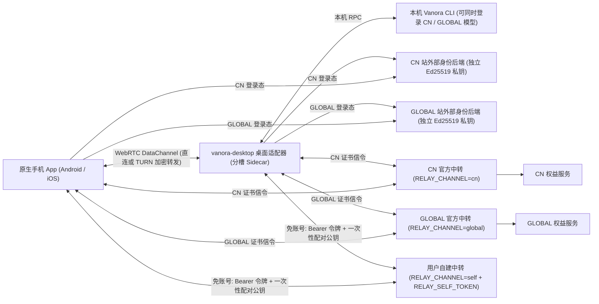

# Vanora Relay

让原生手机 App 连接电脑上的 [Vanora](https://github.com/VANORA-Team/vanora)。支持局域网免账号配对、CN / GLOBAL 官方分站中转，以及免账号的自建中转节点。

- **局域网配对**：桌面为开启 `lan_access` 的会话和工作区分享访问。一次性链接绑定设备密钥，授权可查看和撤销。
- **模型密钥不上云（模型与中转解耦）**：模型 API Key 与供应商登录态仅保留在本地电脑的 Vanora 配置中，不进入中转节点或身份签发后端。用户可在 Vanora 中同时登录 CN 站与 GLOBAL 站，按需交叉使用（例如调用 CN 站模型、走拥有权益的 GLOBAL 官方中转，反之亦然）。
- **官方双站严格隔离（签发闭源、验签开源）**：CN 与 GLOBAL 官方中转分别固定各自站点的独立 Ed25519 公钥（可叠加 `RELAY_ALLOWED_ISSUER` 白名单），并仅校验各自站点的中继权益，两站账号与权益彼此独立、互不共享。设备证书签发私钥与账号鉴权流程由部署方的外部身份后端独立持有，信令与权益服务均无法伪造端点身份。
- **直接复用宿主客户端登录态**：官方渠道下，桌面端与移动端分别复用 CN 站或 GLOBAL 站宿主客户端已有的认证令牌完成设备注册与续期，不引入独立的账号密码体系；桌面 Sidecar 按渠道分槽保存凭据，支持不中断本地任务的渠道热切换。
- **自建中转免账号自管鉴权**：用户可设置 `RELAY_CHANNEL=self` 与 `RELAY_SELF_TOKEN` 自建节点，无需登录任何官方账号，也不依赖外部身份签发后端。节点令牌用于防止 URL 外泄后被他人占用，桌面与手机通过一次性配对链接绑定本机 Ed25519 设备公钥，仅开放显式开启 `self_access` 的资源，并支持随时撤权。
- **直连优先、按需中继**：优先通过 STUN 建立端到端直连，具备中继权益（官方渠道）或通过配对授权（自建渠道）时自动支持 TURN 转发；AI 对话正文只在两端加密 DataChannel 内流转。

---

## 架构概览



| 组件 | 职责 | 安全边界与说明 |
| --- | --- | --- |
| 外部身份签发后端（仅官方渠道） | 校验 CN 或 GLOBAL 对应站点宿主令牌，为端点公钥签发短期 `vanc1` 证书与 `vanl1` 活性租约 | CN 与 GLOBAL 独立部署、独立持有签名私钥（接口约定见 [`internal/identity/README.md`](internal/identity/README.md)） |
| `relay` | 信令路由、STUN 列表下发与 TURN 中继；官方渠道按站验签并查单站权益，自建渠道以 `RELAY_SELF_TOKEN` + 本机公钥 PoP 放行 | 不接触 AI 对话正文；官方渠道绝不跨站放行；自建渠道零外部账号依赖 |
| `vanora-desktop` | 启动并托管本机 Vanora RPC 进程、执行会话与工具 ACL | 按渠道分槽存储（`account-cn.enc` / `account-global.enc` / `self.enc` / `lan.enc`）；支持独立运行与 Sidecar 热切换 |
| `mobile` / `native` | 封装官方双站客户端、免账号自建配对客户端与局域网客户端 | 提供 Android AAR 与 iOS XCFramework 原生绑定 |

---

## 文档导航

详细部署、配置、接入与协议说明已整理至 [`docs/`](docs/README.md)：

| 文档 | 内容说明 |
| --- | --- |
| [服务端部署与权益校验](docs/deployment.md) | CN / GLOBAL 单站隔离部署、`RELAY_ALLOWED_ISSUER`、权益接口，以及零外部依赖的自建节点（`RELAY_CHANNEL=self`）部署步骤 |
| [桌面适配器指南](docs/desktop.md) | `vanora-desktop` 双站分槽管理、Sidecar 渠道热切换与自建配对命令、`desktop.json`（含 `lan_access` / `self_access`）权限配置 |
| [移动端 SDK 接入指南](docs/mobile.md) | Android AAR / iOS XCFramework 构建、CN / GLOBAL 双槽接入、免账号自建配对接入（`NewSelfRelayClient`）与事件循环约定 |
| [协议与自定义客户端参考](docs/protocol.md) | 官方端点接入时序、自建免账号配对信令与 HMAC 证明规范、非 Go 客户端签名规范与业务协议 |

**模块与设计文档**：[架构设计与验收场景](DESIGN.md) · [外部身份签发协议与验签规范](internal/identity/README.md) · [STUN / TURN 详细配置](internal/ice/README.md)

---

## 快速开始与测试

模块最低要求为 **Go 1.25**，仓库默认使用 **Go 1.27.4** 构建和测试。

```sh
# 构建服务端与桌面端二进制
go build ./cmd/...

# 运行单元与端到端集成测试（双站隔离、自建配对、信令、WebRTC、身份验签、STUN/TURN 与两端适配器）
go test ./...
```

如需驱动真实 Vanora CLI 验证断线续跑、事件补发与 `request_id` 去重（测试中的模型响应由本机 HTTP 测试服务模拟）：

```sh
VANORA_TEST_CLI=/abs/path/to/vanora/packages/coding-agent/dist/cli.js \
  go test ./mobile -run TestUpstreamVanoraRunAfterNetworkLoss -count=1
```

> [!NOTE]
> 公网 NAT 穿透兼容性需在部署到公网可达节点后，使用真实手机蜂窝网络与家庭网络进行验收。

---

## 目录结构

| 路径 | 说明 |
| --- | --- |
| `docs/` | 部署、桌面端、移动端与协议详细文档 |
| `cmd/relay` | 信令与 STUN/TURN 统一服务端进程 |
| `cmd/vanora-desktop` | 桌面端适配器 CLI 与多渠道 Sidecar（`login`、`serve`、`whoami`、`status`、`logout`） |
| `internal/identity` | 设备证书 / 租约验签、远程用户 ID 推导、自建设备 ID / 配对证明与客户端 PoP 签名输入 |
| `internal/signal` | WebSocket 信令集线器（官方分站模式与自建免账号模式）、设备目录与连接路由 |
| `internal/ice` | STUN/TURN 服务端、grant 生命周期与流量计数 |
| `internal/membership` | 单站外部权益校验 HTTP 客户端 |
| `protocol` | 信令消息格式与 Ed25519 签名 / 验签 |
| `endpoint` | 官方端点证书校验、设备卡验证、签名协商与租约访问控制 |
| `adapter/` | 账号管理（`account`）、局域网配对（`lan`）、自建免账号配对（`selfrelay`）、官方 WebRTC 传输（`transport`）、桌面业务适配器（`desktop`） |
| `mobile` | 面向 `gomobile` 绑定的移动端 Go SDK |
| `native/` | Android AAR 构建脚本与 Keystore 封装、iOS Keychain 封装 |
