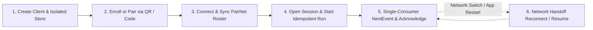

# Mobile SDK Integration Guide

[← Desktop Adapter](desktop.md) · [Docs Hub](README.md) · [Protocol Reference →](protocol.md) · [简体中文](../mobile.md) | **English**

The `mobile/` and `native/` packages provide `gomobile` native bindings (Android AAR and iOS XCFramework) encapsulating official dual-site relays, account-free self-hosted relays, LAN mutual-TLS direct links, WebRTC transport, multi-desktop Pairing Networks, event cursor recovery, and remote tool approvals.

---

## 1. End-to-End Integration Lifecycle



---

## 2. Channel Constructors & Isolated Storage Slots

All four channels share the exact same session, run, and event-loop APIs, but **each channel must receive its own dedicated secure `Store` slot**:

| Channel | Go / Android Constructor | iOS Constructor | Account Required | Suggested Slot | Initial Setup |
| :--- | :--- | :--- | :---: | :---: | :--- |
| **CN Official** | `NewClient(idURL, sigURL, cnPubHex, store)` | `MobileNewClient(...)` | CN account | `"cn"` | `Enroll(cnToken)` → `Pair(input, "", "", name)` |
| **GLOBAL Official** | `NewClient(idURL, sigURL, glPubHex, store)` | `MobileNewClient(...)` | GLOBAL account | `"global"` | `Enroll(glToken)` → `Pair(input, "", "", name)` |
| **Self-Hosted (`self`)** | `NewSelfRelayClient(store)` | `MobileNewSelfRelayClient(store)` | **None** | `"self"` | `Pair(input, selfSigURL, relayToken, name)` |
| **LAN Direct (`lan`)** | `NewLANClient(store)` | `MobileNewLANClient(store)` | **None** | `"lan"` | `Pair(input, "", "", name)` |

> [!IMPORTANT]
> **Strict Official Site Isolation**: CN and GLOBAL use separate identity public keys, signaling relays, and entitlements. When a user signs into both sites, allocate separate `"cn"` and `"global"` stores—pointing a different authority public key at an existing store returns `account: stored state belongs to another authority`.

---

## 3. Pairing, Reconnecting & Multi-Desktop PairNet

### First-Time Pairing (`Pair`)

Call `Pair(input, signalURL, relayToken, clientName)`:

- `input` accepts either a **full scanned URI** or a **16-character typed code** (case-, space-, and hyphen-insensitive).
- **Official channels**: Pass empty strings for `signalURL` and `relayToken`; the client uses its configured site endpoint.
- **Self-hosted channel**: Leave `signalURL` empty when scanning a QR URI; pass `signalURL` when typing a 16-char code. Invitations include the relay token by default; pass `relayToken` only when the desktop created the invite with `include_token: false`.
- **LAN channel**: LAN codes append `@privateIP:port`; if you pass a bare 16-char code, provide `privateIP:port` as `signalURL`.

### Reconnecting Paired Desktops

Once paired, one-time invitation secrets are stripped automatically. Subsequent app launches reconnect using persisted device bindings:

| Channel | Persisted Target | Reconnect Call |
| :--- | :--- | :--- |
| **Official (`cn` / `global`)** | `device_id` and `owner` from `ConnectionState()` | `Connect(deviceID, ownerID)` |
| **Self-Hosted (`self`)** | `SelfRelayTarget()` in secure storage (retains node token, omits one-time `pair`) | `ConnectSelfRelay(savedTarget, name)`<br>*(or `ConnectSelfRelayWithToken(target, token, name)`)* |
| **LAN (`lan`)** | `LANAddress()` in secure storage | `ConnectLAN(savedAddress, name)` |

If `access.state` emits `pairing_required`, the phone was revoked or unpaired—prompt the user to create a new invitation on the desktop.

### Pairing Network & Multiple Concurrent Desktops

- **Inspect Roster**: `PairingNetwork()` returns a JSON array of members in the active channel with stable `id` and `role` (`"mobile"` or `"desktop"`).
- **Concurrent Desktop Handles**: Call `OpenNetworkDesktop(id)` on the main client to obtain an independent `*Client` handle per desktop (returns the main client itself for the primary selected desktop). Each handle maintains its own requests, subscriptions, and event cursors; closing the main client closes all child handles.
- **Remove Member**: `RemoveNetworkDevice(id)` removes a phone or desktop and broadcasts the change across authenticated links.
- **Indirect Pairing Default Access**: On `self` / `lan`, desktops discovered transitively default to `read` access; grant execution via a `control` invite from that desktop or dynamically via `access.client.access.set`.

---

## 4. Android Integration

### Build AAR

**Requirements**: JDK (`javac --release 8`), Go 1.26+, Python 3, Android SDK (`ANDROID_HOME` or `ANDROID_SDK_ROOT`), and NDK (optional `ANDROID_NDK_HOME`).

```sh
# Run from repo root; builds dist/vanora-mobile.aar (minSdk 23, arm64-v8a + x86_64)
python native/android/build.py
```

1. Copy `dist/vanora-mobile.aar` into `libs/` and add `implementation(files("libs/vanora-mobile.aar"))`.
2. Declare `<uses-permission android:name="android.permission.INTERNET" />` in `AndroidManifest.xml`.
3. **Invoke all network and `nextEvent` calls off the main UI thread (e.g. `Dispatchers.IO`)**.

### Kotlin Example

```kotlin
import mobile.Mobile
import org.json.JSONArray
import org.vanora.relay.AndroidAccountStore

// 0. Bind Application Context on startup
go.Seq.setContext(applicationContext)

// --- Option A: Official Site (CN slot shown; use a separate "global" slot for GLOBAL) ---
val cnStore = AndroidAccountStore(applicationContext, "cn")
val cnClient = Mobile.newClient(cnIdentityUrl, cnSignalUrl, cnPinnedPublicKeyHex, cnStore)
cnClient.enroll(cnHostAccessToken)
cnClient.updateToken(refreshedCnToken)
cnClient.pair(scannedLinkOrTypedCode, "", "", "Pixel 9")
val stateJson = cnClient.connectionState() // state, path ("direct"|"relay"), device_id, owner

// --- Option B: Account-Free Self-Hosted Relay ---
val selfStore = AndroidAccountStore(applicationContext, "self")
val selfClient = Mobile.newSelfRelayClient(selfStore)
selfClient.pair(scannedLinkOrTypedCode, selfSignalUrl, "", "Pixel 9")
val savedReconnectTarget = selfClient.selfRelayTarget() // persist for reconnects

// --- Option C: LAN Direct + Concurrent Desktops ---
val lanStore = AndroidAccountStore(applicationContext, "lan")
val lanClient = Mobile.newLANClient(lanStore)
lanClient.pair(scannedLinkOrTypedCode, "", "", "Pixel 9")
val members = JSONArray(lanClient.pairingNetwork())
val desktopA = lanClient.openNetworkDesktop(firstDesktopId)
val desktopB = lanClient.openNetworkDesktop(secondDesktopId)
val sessionsA = desktopA.listSessions()
val sessionsB = desktopB.listSessions()

// --- Unified AI Session & Remote Approval API (identical across all channels) ---
val workspaces = selfClient.listWorkspaces()
val reqId = Mobile.newRequestID() // persist before sending for idempotent retries
val created = selfClient.createSession(selectedWorkspaceId, reqId, "New Chat")
val snapshot = selfClient.openSession(selectedSessionId)
selfClient.startRun(selectedSessionId, Mobile.newRequestID(), "Summarize recent changes")
selfClient.respondUI(selectedSessionId, runId, uiId, """{"confirmed":true}""")
```

---

## 5. iOS Integration

### Build XCFramework

Run on macOS with Xcode installed:

```sh
go install golang.org/x/mobile/cmd/gobind
export PATH="$(go env GOPATH)/bin:$PATH"
mkdir -p dist
go tool gomobile bind -target=ios,iossimulator -o dist/Mobile.xcframework ./mobile
```

1. Add `dist/Mobile.xcframework`, [VanoraAccountStore.h](../../native/ios/VanoraAccountStore.h), and [VanoraAccountStore.m](../../native/ios/VanoraAccountStore.m) to your App Target.
2. Enable ARC and link `Security.framework` (Keychain-backed storage).
3. Instantiate separate `VanoraAccountStore` profiles per channel:
   - **CN / GLOBAL Official**: `VanoraAccountStore(profile: "cn")` / `"global"` → `MobileNewClient(...)`
   - **Self-Hosted**: `VanoraAccountStore(profile: "self")` → `MobileNewSelfRelayClient(selfStore, &err)`
   - **LAN Direct**: `VanoraAccountStore(profile: "lan")` → `MobileNewLANClient(lanStore, &err)`

```objc
// Objective-C example (Swift bridges the same symbols via Bridging Header)
NSError *err = nil;
VanoraAccountStore *selfStore = [[VanoraAccountStore alloc] initWithProfile:@"self"];
MobileClient *client = MobileNewSelfRelayClient(selfStore, &err);
[client pair:scannedLinkOrCode signalURL:selfSignalURL relayToken:@"" clientName:@"iPhone 16" error:&err];
NSString *savedTarget = [client selfRelayTarget];
```

---

## 6. Public API Quick Reference & Event-Loop Contract

<details>
<summary>Expand Client public method summary</summary>

| Category | Methods | Description |
| :--- | :--- | :--- |
| **Identity** *(official)* | `Enroll(token)` / `UpdateToken(token)` / `Reset()` / `UserID()` / `DeviceID()` | Bind host token, renew credentials, or rotate endpoint keys when switching accounts |
| **Pairing & Connect** | `Pair(input, sigURL, token, name)` / `Connect(devID, owner)` / `ConnectSelfRelay(link, name)` / `ConnectSelfRelayWithToken(link, token, name)` / `ConnectLAN(link, name)` | First-time pairing or reconnect with persisted targets |
| **State & Lifecycle** | `ConnectionState()` / `Reconnect()` / `Disconnect()` / `Close()` / `Devices()` / `SelfRelayTarget()` / `LANAddress()` | Inspect link & transport path, handle handoffs, release resources |
| **Pairing Network** | `PairingNetwork()` / `OpenNetworkDesktop(id)` / `RemoveNetworkDevice(id)` | Roster inspection and concurrent multi-desktop handles |
| **Sessions, Runs & Collaboration** | `ListWorkspaces()` / `CreateSession(...)` / `ListSessions()` / `OpenSession(sessID)` / `CloseSession(sessID)` / `SessionPresence(sessID, watch)` / `Resume(sessID, afterSeq)` / `StartRun(...)` / `StartRunWithPolicy(sessID, reqID, text, policy)` / `CancelRun(...)` / `RespondUI(...)` / `SubmitGuestRequest(...)` / `RespondGuestRequest(...)` / `RespondGuestRequestWithOptions(...)` | Uniform AI session control, FIFO turn queueing, live collaborator presence, remote tool approvals, and guest prompt gating |
| **Events** | `NextEvent(timeoutMillis)` / `Acknowledge(sessID, seq)` / `Mobile.NewRequestID()` | Single-consumer event pump and sequence acknowledgment |

</details>

### Client Engineering Checklist

- **Single-Consumer Event Loop**: Spawn exactly **one background consumer** per `*Client` calling `NextEvent(timeoutMillis)`. Expect business events (with `seq`) plus four control event types:
  - `connection.state`: transport state and path (`direct` / `relay` / `lan`) transitions
  - `auth.state`: official credentials expired (`login_required`)
  - `access.state`: device unpaired/revoked (`pairing_required`) or invalid self-hosted token (`relay_token_invalid`)
  - `subscription.error`: cursor fell behind retention (`snapshot_required`) or resource unavailable
- **Idempotent Prompt Submission**: Persist `NewRequestID()` alongside the prompt text before invoking `StartRun` or `CreateSession`, and reuse both across retries.
- **Cursor Acknowledgment & Snapshot Rebuild**: Call `Acknowledge(sessionID, seq)` immediately after applying and storing each sequenced event. Upon `snapshot_required`, call `OpenSession(sessionID)` to replace local state cleanly.
- **Network Handoffs & App Restarts**: Call `Reconnect()` when switching between Wi-Fi and cellular or returning to the foreground. After process restarts, reconnect using the channel's persisted target and call `Resume(sessionID, lastAppliedSeq)`.
- **Cleanup**: Always call `Close()` when switching profiles or tearing down a client to release WebRTC, signaling, and child desktop resources.
