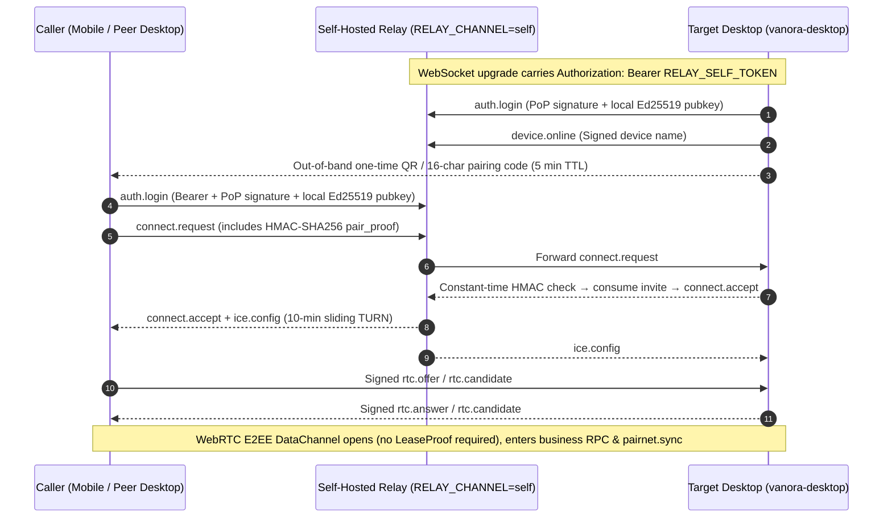

# Protocol & Custom Client Reference

[← Mobile SDK](mobile.md) · [Docs Hub](README.md) · [Security Model →](security.md) · [简体中文](../protocol.md) | **English**

Go applications can import `endpoint`, `adapter/transport`, and `adapter/selfrelay` directly. Authors implementing clients in other languages should follow this specification. A runnable end-to-end reference test lives in [internal/signal/integration_test.go](../../internal/signal/integration_test.go).

---

## 1. Official Channel Handshake (`cn` / `global`)

CN and GLOBAL operate separate external identity authorities and independent Ed25519 trust roots (optionally reinforced by `RELAY_ALLOWED_ISSUER`). Cross-site certificates are rejected during `auth.login`.

```mermaid
sequenceDiagram
    autonumber
    participant Caller as Caller (Mobile / Peer Desktop)
    participant Auth as External Identity Authority
    participant Relay as Official Relay (WSS /v1/signal)
    participant Desktop as Target Desktop (vanora-desktop)

    Caller->>Auth: /challenges → /enroll → /lease (Host Token + PoP)
    Auth-->>Caller: Short-lived vanc1 cert + <=60s vanl1 lease
    Desktop->>Relay: auth.login + device.online (Signed card + guests)
    Relay-->>Desktop: device.registered (includes pairing_ticket)

    Caller->>Relay: auth.login (Signed auth.challenge response)
    Caller->>Relay: connect.request (First-time HMAC proof + optional role/name)
    Relay->>Desktop: Forward connect.request
    Desktop-->>Relay: Verify identity / ACL / pairing proof → connect.accept
    Relay-->>Caller: Forward connect.accept + ice.config (Caller entitlement)
    Relay-->>Desktop: ice.config

    Caller->>Desktop: Signed rtc.offer / rtc.candidate (anti-replay)
    Desktop-->>Caller: Signed rtc.answer / rtc.candidate
    Note over Caller,Desktop: WebRTC DataChannel "vanora" opens; exchange LeaseProof as first frame
    Caller->>Desktop: Business RPC (pairnet.sync / session.* / run.* / ui.respond)
    Desktop-->>Caller: Streaming events & results (text.delta / tool.* / ui.request / result)
```

### Step-by-Step Requirements

1. **Keys & Credentials**: Generate and retain an Ed25519 private key per site slot in OS secure storage, pinning that site's identity authority public key. Follow the [External Identity Contract](../../internal/identity/README.md) to exchange a host token via `/challenges` and `/enroll` for a short-lived `vanc1` certificate, call `/lease` for a `<= 60s` `vanl1` liveness lease, and refresh via `/renew`.
2. **Signaling Auth & Online Card**: Connect to `wss://<relay>/v1/signal` and sign `auth.challenge` via `auth.login`. Desktops then publish `device.online` containing a signed device card and allowed guest list, receiving `device.registered`. Republish the full list whenever ACLs change.
3. **First-Time Pairing**: Scan `vanora://pair/cn#...` or `vanora://pair/global#...`, or resolve a 16-char code to recover the same URI. Verify fragment `relay` matches the configured site; `device`, `owner`, and `pin` pin the desktop identity, and `pair` is the 32-byte one-time secret (all base64url unpadded).
4. **Connection Handshake**:
   - Caller sends signed `connect.request` (self-connection `from == to` is forbidden):
     - Legacy mobile body: empty (reconnect) or raw 32-byte HMAC (first-time pairing; formula in §2.4).
     - Extended JSON body (PC-to-PC & modern clients): `{"role":"desktop"|"mobile","name":"<optional>","proof":"<optional base64url HMAC>"}`.
   - Target desktop validates certificate, signature, local ACL, and pairing proof before persisting the peer's public key, consuming the one-time invite, and emitting `connect.accept`. Unpaired callers receive `connect.closed` (`"access_denied"`).
   - Caller verifies the desktop certificate, pinned public key, and connection nonce via `Session.Accepted`.
5. **ICE Routing & Refresh**: `ice.config.data` carries standard `RTCIceServer[]`. Both sides gather direct and relay candidates in parallel, preferring direct paths when reachable. Callers may send `ice.refresh` (with `connection_id`) at intervals `>= 10s` (recommended every `30s` and after certificate renewal).
6. **Signed WebRTC Signaling**: Seal every `rtc.offer`, `rtc.answer`, and `rtc.candidate` with `Session.Seal` and verify via `Session.Open` before passing to WebRTC. Connection ID, identities, round, sequence number, and desktop nonce bind each message against replay. **Process callbacks per connection serially.**
7. **Liveness Lease & Access Control**:
   - Send `auth.lease` to signaling before certificate or lease expiry.
   - Exchange `endpoint.LeaseProof` as the **first frame** inside DataChannel `"vanora"`; reject all business frames until verified.
   - On authority loss, desktops immediately invoke `AuthorityLost()`, halting new sessions and tool execution while capping existing read-only access at `60s` past the last valid lease.

---

## 2. Self-Hosted Account-Free Protocol (`RELAY_CHANNEL=self`)

Self-hosted relays use neither `vanc1`/`vanl1` certificates nor external identity/entitlement backends, enforcing pairing-only access (Go reference in `adapter/selfrelay`):



### 2.1 Self Device ID Derivation

Both endpoints generate a local 32-byte Ed25519 private key and derive their device ID deterministically:

```text
device_id = "sdev_" + lowercase(base32_nopad(SHA256("vanora/self-device/v1\x00" || raw_pubkey)[:16]))
```

### 2.2 Node Gate & PoP Login

- WebSocket upgrades require `Authorization: Bearer <RELAY_SELF_TOKEN>` (HTTP `401` otherwise).
- Reply to `auth.challenge` with signed `auth.login` (`certificate` empty, `from: sdev_...`, `to: "signal"`):

```json
{"role": "desktop", "public_key": "<unpadded base64url 32B pubkey>"}
```

- After verifying `from == SelfDeviceID(public_key)` and the Ed25519 signature, the hub replies `auth.ok` (`{"device_id":"sdev_...","mode":"self"}`). `devices.list` (`directory_unavailable`) and `auth.lease` (`lease_unsupported`) are disabled.

### 2.3 Desktop Presence & Invitation URI

Desktops send `device.online` with a signed `device.card` (`to: "self"`, empty `certificate` and `guests`). One-time 5-minute invitation URIs place all secrets inside `#fragment` so they never reach HTTP logs or proxies:

```text
https://<relay-host>/v1/signal#mode=self&pin=<base64url(desktop_pub)>&pair=<base64url(32B_pair_token)>&token=<optional_relay_self_token>
```

### 2.4 HMAC One-Time Pairing & Reconnect

- Caller sends signed `connect.request` (`seq: 1`, `from != to`) to `SelfDeviceID(desktop_pub)`:

```json
{
  "public_key": "<base64url(caller_pub)>",
  "name": "<device name>",
  "role": "desktop",
  "pair_proof": "<base64url(HMAC) on first pairing>"
}
```

- Rather than transmitting `pair` directly, the caller proves possession of it:

```text
pair_proof = HMAC-SHA256(
    raw_pair_token,
    "vanora-self-pair-v1\n" + connection_id + "\n" + base64url(caller_pub) + "\n" + base64url(desktop_pub)
)
```

- Target desktop checks `self.enc` and PairNet first; if unpaired, it constant-time checks all unexpired invites, consumes the matching invite, and persists the peer key and access level (`read`/`control`).
- **Anti-Escalation**: An already-paired peer submitting a new invite keeps its existing permission level and **does not** consume that invite. Unauthorized requests receive `connect.closed` (`"access_denied"`).
- Authorized peers receive signed `connect.accept` (`seq: 1`, `{"nonce":"<32-hex>","public_key":"<desktop_pub>"}`); the caller verifies `public_key` matches its pinned `pin`.

### 2.5 Sliding TURN Grants

Upon `connect.accept`, the relay issues STUN plus a `10-minute` TURN grant renewed via `ice.refresh` every `30s`. Revocation or `connect.close` terminates the TURN allocation immediately. DataChannel opens directly into business frames without `LeaseProof`.

---

## 3. 16-Character Encrypted Pairing Codes (All Channels)

To support manual code entry without revealing invitation secrets to the relay:

1. **Secret Generation**: Desktop draws 10 random bytes and encodes them using unambiguous Base32 alphabet `23456789ABCDEFGHJKLMNPQRSTUVWXYZ` into 16 characters grouped in fours (clients strip spaces/hyphens and ignore case).
2. **Key & Locator Derivation** (`\x00` is one zero byte; base64url is unpadded):
   ```text
   locator = base64url(SHA256("vanora/lookup/v1\x00" || secret))
   key     = SHA256("vanora/invite/v1\x00" || secret)
   ```
3. **End-to-End Encryption**: Encrypt the UTF-8 invitation URI with AES-256-GCM using ASCII `locator` bytes as AAD:
   ```text
   box = base64url(12B_random_nonce || ciphertext || 16B_gcm_tag)
   ```
4. **Publish & Lookup**:
   - **WAN (Official / Self)**: Online desktops `POST /v1/signal` with `Authorization: Bearer <pairing_ticket>`, `Vanora-Desktop: <device_id>`, and body `{"locator":"...","box":"...","expires_at":"<RFC3339>"}`. Callers `GET /v1/signal?pairing=<locator>` and decrypt `box` locally.
   - **LAN**: Pairing codes append `@privateIP:port`; callers fetch `https://IP:port/v1/lan?pairing=<locator>` with their client cert, decrypt the invite, verify the address, and pin the public key fingerprint on the mTLS connection.
5. **Cleanup**: Records are deleted upon redemption, explicit revocation, expiration, or desktop disconnect.

---

## 4. Decentralized Pairing Network Sync (PairNet)

Over an authenticated channel, callers send `pairnet.sync` and target desktops reply with `pairnet.state`, exchanging a `members` map keyed by device ID.

### Member Schema & ID Rules

Each entry contains `id`, `role` (`"mobile"` or `"desktop"`), `pin`, `epoch`, `change`, and optional `owner`, `name`, `address`. Supports `mobile ↔ desktop` and `desktop ↔ desktop` links (`mobile ↔ mobile` and self-pairing are forbidden).

| Channel | Member `id` | Notes |
| :--- | :--- | :--- |
| **Official (`cn` / `global`)** | Certificate `device_id` (`dev_...`) | `owner` is `remote_user_id` |
| **Self Desktop** | 32-byte Ed25519 public key (`pin`) | Identical whether hosting or controlling |
| **Self Mobile** | Public key fingerprint | — |
| **LAN** | Public key fingerprint | Desktop initiators may include `X-Vanora-Client-Role: desktop` and `X-Vanora-Client-Address: <privateIP:port>` on mTLS upgrade so peers learn their reverse address |

### Epoch Merge & Revocation Semantics

- **Parity**: First admission uses `epoch = 1` (odd = active); removal bumps to an even epoch (tombstone); re-invitation bumps to a higher odd epoch.
- **Deterministic Merge**: Endpoints persist tombstones; higher `epoch` always wins, breaking ties within the same epoch by newer `change`.
- **Propagation & Scoped Connections**: Removing a member immediately closes active links and broadcasts updates (optionally sending `pairnet.removed` with `epoch` and `receiver: true` before disconnect). For concurrent multi-desktop dialing, clients may set `desktop` inside signed `auth.login` to open a dedicated outbound-only signaling socket (disallowing `device.online`), while active host desktops may also reuse their primary signaling socket.

---

## 5. Non-Go Client Ed25519 Signing Input

Per [protocol/wire.go](../../protocol/wire.go), Ed25519 signatures sign 8 UTF-8 lines joined by LF (`\n`) with **no trailing newline**:

```text
vanora-relay/v1
<type>
<connection_id>
<from>
<to>
<round>
<seq>
<body_base64url>
```

- `round` and `seq` are base-10 integers (`0` when unset).
- `body` and signature `proof` use **unpadded base64url**.
- Certificate and device-card validation logic lives in [endpoint/session.go](../../endpoint/session.go) and [endpoint/discovery.go](../../endpoint/discovery.go).

---

## 6. DataChannel Framing & Business RPC Protocol

### Transport & Chunking

- **DataChannel Label**: `vanora` (reliable, ordered).
- **Official First Frame**: `{"certificate":"...","lease":"..."}` (re-sent on lease refresh; omitted on `self` and `lan`).
- **Payload Cap & Fragmentation**: UTF-8 JSON up to **64 MiB**.
  - `<= 16 KiB`: sent raw as one message.
  - `> 16 KiB`: split into ordered binary chunks:

```text
 0               4               8               12              16
+---------------+---------------+---------------+---------------+-----------+
| Magic (4 B)   | MsgID (u32 BE)| Index (u32 BE)| Total (u32 BE)| Payload   |
| 00 56 4E 46   | Message ID    | 0-based index | Total chunks  | Raw bytes |
+---------------+---------------+---------------+---------------+-----------+
```

### Business Requests & Responses

Every request includes `type` and a non-empty `request_id` (`<= 256` bytes, no control chars); replies echo `request_id` with `type: "result"` (`data`) or `type: "error"` (`code`).

| `type` | Request Fields | Success `data` | Behavior |
| :--- | :--- | :--- | :--- |
| `workspace.list` | — | `workspaces[]` | Lists workspaces where this caller may create sessions |
| `session.create` | `workspace_id`, `title?` | Session summary | Creates a native Vanora v3 JSONL session (idempotent on `request_id`) |
| `session.list` | — | `sessions[]` | Lists visible sessions (`can_run_tools`, `tools_enabled`, visibility flags, `has_active_run`) |
| `session.open` | `session_id` | `messages`, `last_seq`, `pending_ui?` | Returns ACL-filtered message snapshot, latest sequence, and pending approvals |
| `run.start` | `session_id`, `text` | `run_id` | Replaying same `request_id` + `text` returns existing `run_id`; different text returns `request_conflict` |
| `run.cancel` | `session_id`, `run_id` | `run_id`, `status` | Verifies session ownership & caller permission (unauthorized callers receive `unavailable`) |
| `ui.respond` | `session_id`, `run_id`, `ui_id`, `confirmed`/`value`/`answers`/`cancelled` | `ui_id`, `status` | Answers remote tool confirmation (`confirm`/`select`) or prompt (`ask`/`input`/`editor`) |
| `events.resume` | `session_id`, `after_seq` | `session_id`, `after_seq` | Replays events with `seq > after_seq` and streams live updates; returns `snapshot_required` if behind window |

```json
// 1. Caller starts a run
{"type":"run.start","request_id":"q7","session_id":"s2","text":"Explain this change"}

// 2. Desktop acknowledges with run_id
{"type":"result","request_id":"q7","data":{"run_id":"r5"}}

// 3. Desktop streams monotonically sequenced session events
{"type":"event","session_id":"s2","run_id":"r5","seq":18,"kind":"text.delta","data":{"text":"Updated"}}
```

### Event Kinds & Error Codes

| Category | Values | Notes |
| :--- | :--- | :--- |
| **Text & Reasoning** | `text.delta` / `thinking.delta` | Streaming output and reasoning blocks (reasoning requires visibility grant) |
| **Tool Execution** | `tool.call` / `tool.start` / `tool.update` / `tool.end` | Tool invocations and output (requires tool visibility grant) |
| **Remote Approvals** | `ui.request` / `ui.resolved` | Tool approval & prompt dialogs (strictly isolated to owner or initiating user) |
| **Placeholder** | `sync` | Keeps sequence numbers contiguous for unauthorized viewers without leaking payloads |
| **Run Lifecycle** | `run.completed` / `run.cancelled` / `run.failed` | Terminal run events |

| Error Code | Meaning |
| :--- | :--- |
| `unavailable` | Resource hidden, missing, unauthorized, or currently unavailable (uniform anti-enumeration response) |
| `tool_denied` | Missing prompt/tool execution permission, or disallowed slash command |
| `request_conflict` | Reused `request_id` with mismatched prompt payload |
| `snapshot_required` | `events.resume` cursor fell behind retention; call `session.open` |
| `snapshot_too_large` | Snapshot exceeds configured `max_snapshot_bytes` |
| `invalid_request` | Malformed JSON, invalid `request_id`, or bad parameters |

---

## Related Specs

- [External Identity Authority Contract](../../internal/identity/README.md)
- [STUN / TURN Internals & Byte Accounting](../../internal/ice/README.md)
- [Security Model & Verification](security.md)
- [Architecture Design & Acceptance](design.md)
