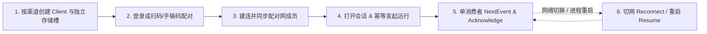

# 移动端 SDK 接入指南

[← 桌面适配器](desktop.md) · [文档中心](README.md) · [协议参考 →](protocol.md) · **简体中文** | [English](en/mobile.md)

`mobile/` 与 `native/` 目录提供基于 `gomobile` 的移动端原生绑定（Android AAR / iOS XCFramework），开箱封装官方分站中转、免账号自建配对中转、局域网 mTLS 直连、WebRTC 传输、配对网多电脑并发、事件游标恢复与远程工具审批。

---

## 1. 接入全流程概览



---

## 2. 四通道构造与存储隔离

四种连接方式共用完全一致的会话、运行与事件循环 API，但**必须为每个渠道提供独立的安全存储槽位（`Store`）**，切勿复用同一存储槽：

| 通道 | Go / Android 构造器 | iOS 构造器 | 账号要求 | 推荐存储槽名 | 首次接入方式 |
| :--- | :--- | :--- | :---: | :---: | :--- |
| **CN 官方中转** | `NewClient(idURL, sigURL, cnPubHex, store)` | `MobileNewClient(...)` | 登录 CN 站 | `"cn"` | `Enroll(cnToken)` → `Pair(input, "", "", name)` |
| **GLOBAL 官方中转** | `NewClient(idURL, sigURL, glPubHex, store)` | `MobileNewClient(...)` | 登录 GLOBAL 站 | `"global"` | `Enroll(glToken)` → `Pair(input, "", "", name)` |
| **自建中转 (`self`)** | `NewSelfRelayClient(store)` | `MobileNewSelfRelayClient(store)` | **免账号** | `"self"` | `Pair(input, selfSigURL, relayToken, name)` |
| **局域网直连 (`lan`)** | `NewLANClient(store)` | `MobileNewLANClient(store)` | **免账号** | `"lan"` | `Pair(input, "", "", name)` |

> [!IMPORTANT]
> **官方双站严格隔离**：CN 与 GLOBAL 使用独立的身份公钥与信令节点，权益互不共享。用户同时登录两站时，请分别为其创建 `"cn"` 与 `"global"` 存储槽按需切换；若把不同身份公钥指向同一存储槽，SDK 会直接返回 `account: stored state belongs to another authority`。

---

## 3. 配对、重连与多电脑配对网

### 首次配对（`Pair`）

统一调用 `Pair(input, signalURL, relayToken, clientName)`：

- `input` 支持**扫码完整链接**或 **16 位手输码**（自动忽略大小写、空格和短横线）。
- **官方渠道**：`signalURL` 与 `relayToken` 传空字符串，使用构造时配置的站点节点。
- **自建渠道**：扫码链接已包含节点地址，可留空 `signalURL`；输入 16 位手输码时须传入 `signalURL`。邀请默认携带节点令牌，仅在桌面创建邀请时显式传 `include_token: false` 时才需另传 `relayToken`。
- **局域网渠道**：局域网手输码自带私网地址（`XXXX-XXXX-XXXX-XXXX@私网IP:端口`）；如仅输入 16 位码，可通过第二个参数 `signalURL` 传入 `私网IP:端口`。

### 重连已配对电脑

配对成功后，一次性邀请凭据会自动剥离，后续重启 App 直接使用已绑定的设备密钥重连：

| 渠道 | 本地持久化目标 | 重连调用 |
| :--- | :--- | :--- |
| **官方 (`cn` / `global`)** | `ConnectionState()` 中的 `device_id` 与 `owner` | `Connect(deviceID, ownerID)` |
| **自建 (`self`)** | 安全存储 `SelfRelayTarget()` 返回值（保留节点令牌、已剥离一次性 `pair`） | `ConnectSelfRelay(savedTarget, name)`<br>*(外置令牌时用 `ConnectSelfRelayWithToken(target, token, name)`)* |
| **局域网 (`lan`)** | 安全存储 `LANAddress()` 返回值 | `ConnectLAN(savedAddress, name)` |

收到 `access.state` 中的 `pairing_required` 时，表示本机被桌面撤权或尚未配对，应引导用户在电脑端生成新邀请。

### 配对网与多台电脑并发

- **查看成员**：`PairingNetwork()` 返回当前渠道成员 JSON 数组，每项包含稳定 `id`、`role`（`"mobile"` / `"desktop"`）等字段。
- **同时操控多台电脑**：在主客户端调用 `OpenNetworkDesktop(id)` 获取对应电脑的独立 `*Client` 句柄（打开当前已选电脑时返回主客户端本身）。每台电脑维护各自的请求队列、订阅与事件游标；主客户端关闭时会自动清理所有子句柄。
- **移除成员**：`RemoveNetworkDevice(id)` 可移除手机或电脑，变更通过在线认证链路广播同步；离线设备在下次重连时同步状态。
- **间接配对默认权限**：在 `self` / `lan` 渠道下，经配对网间接发现的新电脑默认授予 `read` 权限；如需执行任务，可由该电脑重新签发 `control` 邀请，或在被控电脑端通过 `access.client.access.set` 动态升权。

---

## 4. Android 接入指南

### 构建 AAR

**环境依赖**：JDK（支持 `javac --release 8`）、Go 1.26+、Python 3、Android SDK（设置 `ANDROID_HOME` 或 `ANDROID_SDK_ROOT`）及 NDK（可选 `ANDROID_NDK_HOME`）。

```sh
# 在仓库根目录执行，输出 dist/vanora-mobile.aar（minSdk 23，含 arm64-v8a 与 x86_64）
python native/android/build.py
```

1. 将 `dist/vanora-mobile.aar` 放入模块 `libs/`，在 `build.gradle` 中添加 `implementation(files("libs/vanora-mobile.aar"))`。
2. 在 `AndroidManifest.xml` 中声明 `<uses-permission android:name="android.permission.INTERNET" />`。
3. **所有网络与 `nextEvent` 阻塞方法必须在后台线程（如 `Dispatchers.IO`）调用**。

### Kotlin 集成示例

```kotlin
import mobile.Mobile
import org.json.JSONArray
import org.vanora.relay.AndroidAccountStore

// 0. 进程初始化时注入 Application Context
go.Seq.setContext(applicationContext)

// --- 方式 A：官方分站（以 CN 槽位为例，GLOBAL 请使用独立 "global" 槽位）---
val cnStore = AndroidAccountStore(applicationContext, "cn")
val cnClient = Mobile.newClient(cnIdentityUrl, cnSignalUrl, cnPinnedPublicKeyHex, cnStore)
cnClient.enroll(cnHostAccessToken)       // 仅提交 CN 站宿主令牌
cnClient.updateToken(refreshedCnToken)   // 令牌续期时调用
cnClient.pair(scannedLinkOrTypedCode, "", "", "Pixel 9")
val stateJson = cnClient.connectionState() // 含 state / path ("direct"|"relay") / device_id / owner

// --- 方式 B：免账号自建中转 ---
val selfStore = AndroidAccountStore(applicationContext, "self")
val selfClient = Mobile.newSelfRelayClient(selfStore)
selfClient.pair(scannedLinkOrTypedCode, selfSignalUrl, "", "Pixel 9")
val savedReconnectTarget = selfClient.selfRelayTarget() // 持久化供重启重连

// --- 方式 C：局域网直连 + 多电脑并发 ---
val lanStore = AndroidAccountStore(applicationContext, "lan")
val lanClient = Mobile.newLANClient(lanStore)
lanClient.pair(scannedLinkOrTypedCode, "", "", "Pixel 9")
val members = JSONArray(lanClient.pairingNetwork())
val desktopA = lanClient.openNetworkDesktop(firstDesktopId)
val desktopB = lanClient.openNetworkDesktop(secondDesktopId)
val sessionsA = desktopA.listSessions()
val sessionsB = desktopB.listSessions()

// --- 通用 AI 会话与远程审批（四通道 API 完全一致）---
val workspaces = selfClient.listWorkspaces()
val reqId = Mobile.newRequestID() // 先落盘 reqId 再发起请求，确保断线幂等重试
val created = selfClient.createSession(selectedWorkspaceId, reqId, "新对话")
val snapshot = selfClient.openSession(selectedSessionId)
selfClient.startRun(selectedSessionId, Mobile.newRequestID(), "总结最近的变更")
selfClient.respondUI(selectedSessionId, runId, uiId, """{"confirmed":true}""")
```

---

## 5. iOS 接入指南

### 构建 XCFramework

在已安装 Xcode 的 macOS 上执行：

```sh
go install golang.org/x/mobile/cmd/gobind
export PATH="$(go env GOPATH)/bin:$PATH"
mkdir -p dist
go tool gomobile bind -target=ios,iossimulator -o dist/Mobile.xcframework ./mobile
```

1. 将 `dist/Mobile.xcframework` 以及 [VanoraAccountStore.h](../native/ios/VanoraAccountStore.h)、[VanoraAccountStore.m](../native/ios/VanoraAccountStore.m) 添加至 App Target。
2. 启用 ARC 并链接 `Security.framework`（Keychain 隔离存储）。
3. 按渠道实例化独立 `VanoraAccountStore`：
   - **CN / GLOBAL 官方站**：`VanoraAccountStore(profile: "cn")` / `"global"` → `MobileNewClient(...)`
   - **自建中转**：`VanoraAccountStore(profile: "self")` → `MobileNewSelfRelayClient(selfStore, &err)`
   - **局域网直连**：`VanoraAccountStore(profile: "lan")` → `MobileNewLANClient(lanStore, &err)`

```objc
// Objective-C 示例（Swift 可通过 Bridging Header 直接调用同名接口）
NSError *err = nil;
VanoraAccountStore *selfStore = [[VanoraAccountStore alloc] initWithProfile:@"self"];
MobileClient *client = MobileNewSelfRelayClient(selfStore, &err);
[client pair:scannedLinkOrCode signalURL:selfSignalURL relayToken:@"" clientName:@"iPhone 16" error:&err];
NSString *savedTarget = [client selfRelayTarget];
```

---

## 6. 核心 API 速查与事件循环规范

<details>
<summary>展开查看 Client 公开方法速查表</summary>

| 分类 | 方法 | 说明 |
| :--- | :--- | :--- |
| **身份管理** *(官方)* | `Enroll(token)` / `UpdateToken(token)` / `Reset()` / `UserID()` / `DeviceID()` | 绑定宿主令牌、刷新令牌续期、安全重置本机密钥以切换账号 |
| **配对与连接** | `Pair(input, signalURL, relayToken, name)` / `Connect(devID, owner)` / `ConnectSelfRelay(link, name)` / `ConnectSelfRelayWithToken(link, token, name)` / `ConnectLAN(link, name)` | 首次配对或使用已持久化目标重连 |
| **状态、唤醒与多路由** | `ConnectionState()` / `Wakeup(longResume)` / `Probe(timeoutMs)` / `Reconnect()` / `AddRoute(addr)` / `RemoveRoute(addr)` / `Routes()` / `PollActivity()` / `Disconnect()` / `Close()` | 查询状态（含 `generation` 与 `transport_hint`）、无损探活唤醒、管理局域网/Tailnet 多路由并自动回切、后台拉取脱敏运行态势 |
| **配对网** | `PairingNetwork()` / `OpenNetworkDesktop(id)` / `RemoveNetworkDevice(id)` | 成员管理与多电脑并发句柄 |
| **会话、运行与访客提问** | `ListWorkspaces()` / `CreateSession(...)` / `ListSessions()` / `OpenSession(...)` / `Resume(...)` / `StartRun(...)` / `CancelRun(...)` / `RespondUI(...)` / `SubmitGuestRequest(sessID, reqID, text)` / `RespondGuestRequest(sessID, guestReqID, action)` | 全通道一致的 AI 会话、流式控制、远程审批与主人确认型访客提问操作 |
| **事件消费** | `NextEvent(timeoutMillis)` / `Acknowledge(sessID, seq)` / `Mobile.NewRequestID()` | 单消费者阻塞拉取事件并确认游标 |

</details>

### 客户端工程最佳实践 Checklist

- **单消费者事件循环**：每个 `*Client` 仅允许**一个后台协程/线程**循环调用 `NextEvent(timeoutMillis)`。事件包含业务事件（带 `seq`）以及四类系统控制事件：
  - `connection.state`：连接状态与直连/中继路径（`direct` / `relay` / `lan`）变化
  - `auth.state`：官方渠道登录态失效（`login_required`）
  - `access.state`：配对失效（`pairing_required`，全渠道）或自建节点令牌失效（`relay_token_invalid`）
  - `subscription.error`：游标超出保留窗口（`snapshot_required`）或资源不可用
- **幂等提交提示词**：调用 `StartRun` 或 `CreateSession` 前，先本地持久化 `NewRequestID()` 与提示词正文；网络抖动重试必须复用同一组参数。
- **游标推进与快照重建**：业务事件渲染并落盘后，立即调用 `Acknowledge(sessionID, seq)` 更新本地确认游标；收到 `snapshot_required` 时调用 `OpenSession(sessionID)` 全量替换本地快照。
- **前后台与切网恢复**：App 从后台切回前台或发生网络切换时，优先调用 **`Wakeup(longResume)`**（先在现有加密通道内探活并并行检测静默半开死连接，连接健康时零中断保留会话，仅在失活或断开时秒级重建并自动续订游标；单会话恢复失败仅发出 `subscription.error` 而不误杀整条底层连接）；进程重启后先调用对应通道的重连方法，再对活跃会话调用 `Resume(sessionID, lastAppliedSeq)`。后台保活或小组件可调用 **`PollActivity()`** 轻量查询脱敏态势而无需拉起 WebRTC。
- **退出清理**：切换账号或销毁页面配置档时务必调用 `Close()` 释放底层 WebRTC、信令与子句柄资源。
