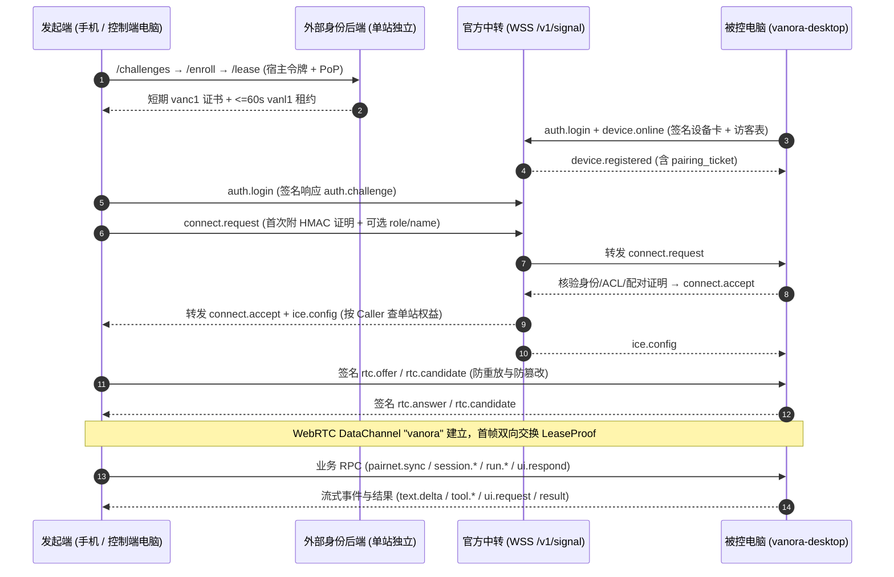
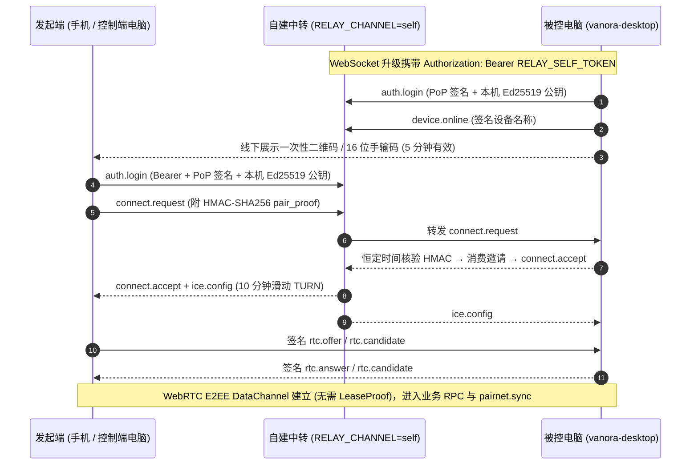

# 协议与自定义客户端参考

[← 移动端 SDK](mobile.md) · [文档中心](README.md) · [安全模型 →](security.md) · **简体中文** | [English](en/protocol.md)

Go 项目可直接复用本仓库的 `endpoint`、`adapter/transport` 与 `adapter/selfrelay` 包；如需以其他语言实现兼容客户端，请遵循本文规范。可运行的端到端参考实现见 [internal/signal/integration_test.go](../internal/signal/integration_test.go)。

---

## 1. 官方渠道接入时序（`cn` / `global`）

官方 `cn` 与 `global` 站各自拥有独立的外部身份后端与 Ed25519 信任根（可叠加 `RELAY_ALLOWED_ISSUER` 校验），跨站证书会在 `auth.login` 阶段被直接拒绝。



### 关键步骤说明

1. **密钥与凭证**：在系统密钥存储按站点分槽生成并保留 Ed25519 私钥，内置对应站点的身份后端公钥。按 [外部身份协议](../internal/identity/README.md) 调用 `/challenges`、`/enroll` 获取短期 `vanc1` 证书，调用 `/lease` 获取最长 `60s` 的 `vanl1` 租约，续期调用 `/renew`。
2. **信令认证与电脑上线**：连接 `wss://<relay>/v1/signal`，收到 `auth.challenge` 后以 `endpoint.OpenCredentials` / `Credentials.Login` 签名回复 `auth.login`。电脑收到 `auth.ok` 后发送 `device.online` 发布签名设备卡与允许访问的远程账号表，收到 `device.registered` 即上线。ACL 变更须立即重新发布完整列表。
3. **首次配对**：扫码取得 `vanora://pair/cn#...` 或 `vanora://pair/global#...` 链接，或解析 16 位手输码还原该链接。fragment 中 `relay` 须匹配当前站点，`device` / `owner` / `pin` 固定目标电脑身份，`pair` 为 32 字节一次性密钥（`pin` 与 `pair` 均为无填充 base64url）。
4. **发起与接受连接**：
   - 发起端发送签名的 `connect.request`（两端与信令均禁止自连 `from == to`）：
     - 兼容纯手机格式：正文为空（复连）或 32 字节原始 HMAC（首次配对，计算规则见 §2.4）。
     - 扩展元数据格式（电脑控机与新客户端）：JSON `{"role":"desktop"|"mobile","name":"<可选名称>","proof":"<可选 base64url HMAC>"}`。
   - 被控电脑依次校验对端证书、签名、本机账号 ACL 与配对证明；验证通过后持久化对端身份与公钥、消耗一次性邀请并签发 `connect.accept`。未配对设备会收到 `connect.closed`（`"access_denied"`）。
   - 发起端通过 `Session.Accepted` 校验目标电脑证书、预期公钥与连接随机数。
5. **ICE 选路与刷新**：`ice.config.data` 为标准 `RTCIceServer[]`。两端并行收集候选并优先直连；有本站点权益时允许 TURN 先行连通并在直连就绪后迁移。发起端可发送 `ice.refresh`（附 `connection_id`）刷新权益与 grant，最小间隔 **10 秒**，建议每 **30 秒**及证书更新后刷新。
6. **签名 WebRTC 协商**：`rtc.offer` / `rtc.answer` / `rtc.candidate` 均须经 `Session.Seal` 签名、接收端经 `Session.Open` 验签后再交付 WebRTC 栈。连接 ID、双方身份、协商轮次、序号与电脑随机数共同防重放。**单条连接的信令回调须串行处理**。
7. **租约续期与访问控制**：
   - 证书或租约临近到期前向信令发送 `auth.lease`（`data` 含 `lease`，换证时同传 `certificate`）。
   - DataChannel 建立后的**首帧**必须交换 `endpoint.LeaseProof`，完成双向校验前拒绝所有业务消息。
   - 电脑检测到身份服务失联时立即调用 `AuthorityLost()`：停止工具执行与新会话接入，既有只读会话最长持续至最后一次成功验租后 `60s`。

---

## 2. 自建免账号渠道协议（`RELAY_CHANNEL=self`）

自建节点不使用 `vanc1`/`vanl1` 证书，不调用任何外部身份后端或权益接口，强制通过一次性配对授权（Go 参考实现见 `adapter/selfrelay`）：



### 2.1 设备标识派生

桌面端与手机端在本机安全存储生成 32 字节 Ed25519 私钥，按统一公式派生自建设备 ID：

```text
device_id = "sdev_" + lowercase(base32_nopad(SHA256("vanora/self-device/v1\x00" || raw_pubkey)[:16]))
```

### 2.2 节点门禁与公钥 PoP 登录

- WebSocket 升级请求必须携带 `Authorization: Bearer <RELAY_SELF_TOKEN>`（缺省或错误返回 HTTP `401`）。
- 收到 `auth.challenge` 后回复签名 `auth.login`：`certificate` 必须为空，`from` 为 `sdev_...`，`to` 为 `"signal"`，`body` 为：

```json
{"role": "desktop", "public_key": "<无填充 base64url 32B 公钥>"}
```

- 节点验证 `from == SelfDeviceID(public_key)` 与签名后返回 `auth.ok`（`{"device_id":"sdev_...","mode":"self"}`）。自建节点禁用 `devices.list`（返回 `directory_unavailable`）与 `auth.lease`（返回 `lease_unsupported`）。

### 2.3 电脑上线与配对链接格式

电脑发送 `device.online`（`card` 为 `type: "device.card"`、`from: sdev_...`、`to: "self"` 的签名设备名称）。桌面生成的 5 分钟一次性邀请链接将全部敏感参数置于 `#fragment`（绝不随 HTTP 请求发送给代理或日志）：

```text
https://<relay-host>/v1/signal#mode=self&pin=<base64url(desktop_pub)>&pair=<base64url(32B_pair_token)>&token=<optional_relay_self_token>
```

### 2.4 HMAC 一次性配对与复连

- 发起端向目标电脑 `SelfDeviceID(desktop_pub)` 发送签名 `connect.request`（`seq: 1`，禁止自连）：

```json
{
  "public_key": "<base64url(caller_pub)>",
  "name": "<设备名称>",
  "role": "desktop",
  "pair_proof": "<首次配对时填写 base64url(HMAC)>"
}
```

- 首次配对时不直接传输 `pair`，而是计算一次性绑定证明：

```text
pair_proof = HMAC-SHA256(
    raw_pair_token,
    "vanora-self-pair-v1\n" + connection_id + "\n" + base64url(caller_pub) + "\n" + base64url(desktop_pub)
)
```

- 被控电脑先查本地 `self.enc` 白名单与配对网；未配对时以恒定时间比对所有未过期邀请的 HMAC，通过后消费邀请并持久化对端公钥与权限（`read`/`control`）。
- **防提权保护**：已配对设备携带新邀请重连时维持原权限且**不消耗**该邀请；未获授权时被控电脑签发 `connect.close`，节点关闭链路并向发起端返回 `connect.closed`（`"access_denied"`）。
- 授权通过后被控电脑签发 `connect.accept`（`seq: 1`，`body` 为 `{"nonce":"<32-hex>","public_key":"<desktop_pub>"}`），发起端核验 `public_key` 与固定 `pin` 一致。

### 2.5 TURN 滑动续期

节点收到 `connect.accept` 后为双方下发 STUN + `10 分钟`短期 TURN 凭证，客户端每 `30 秒`发送 `ice.refresh` 滑动续期；撤权或断连触发 `connect.close` 时立即撤销 TURN Grant。后续 WebRTC 协商信封与官方渠道完全相同，DataChannel 建立后直接承载业务帧（无需 `LeaseProof`）。

---

## 3. 16 位加密手输码规范（全通道通用）

为了在不向中转服务器暴露邀请明文的前提下支持跨设备手输配对码，全部通道共用同一套客户端端到端加密寄存方案：

1. **生成密钥**：桌面随机生成 10 字节 `secret`，采用无混淆 Base32 字母表 `23456789ABCDEFGHJKLMNPQRSTUVWXYZ` 编码为 16 字符，按 4 位分组展示（解析时忽略大小写、空格与短横线）。
2. **派生定位器与加密密钥**（`\x00` 表示单个零字节，所有 base64url 均无填充）：
   ```text
   locator = base64url(SHA256("vanora/lookup/v1\x00" || secret))
   key     = SHA256("vanora/invite/v1\x00" || secret)
   ```
3. **端到端加密**：使用 AES-256-GCM 加密 UTF-8 邀请链接，AAD 为 `locator` 的 ASCII 字节：
   ```text
   box = base64url(12B_random_nonce || ciphertext || 16B_gcm_tag)
   ```
4. **登记与拉取**：
   - **广域网（官方 / 自建）**：在线桌面以 `device.registered.data.pairing_ticket` 作为 `Authorization: Bearer`，附加请求头 `Vanora-Desktop: <device_id>`，向信令路径 `POST /v1/signal` 提交 `{"locator":"...","box":"...","expires_at":"<RFC3339>"}`。客户端 `GET /v1/signal?pairing=<locator>` 获取 `box` 后在本地解密。
   - **局域网**：手输码附带私网地址（`XXXX-XXXX-XXXX-XXXX@IP:端口`），发起端使用本机客户端证书向 `https://IP:端口/v1/lan?pairing=<locator>` 获取密文，解密核对目标地址后再以邀请中的公钥指纹校验实际 mTLS 连接。
5. **自动清理**：成功配对、手动撤销、邀请过期或桌面下线时自动清除节点上的寄存密文。

---

## 4. 去中心化配对网同步（PairNet）

认证通道建立后，发起端发送 `pairnet.sync`，被控桌面回复 `pairnet.state`，双方交换以设备 ID 为键的 `members` 映射表。

### 成员格式与标识规则

每个成员包含：`id`、`role`（`"mobile"` / `"desktop"`）、`pin`、`epoch`、`change`，以及可选字段 `owner`、`name`、`address`。支持 `mobile ↔ desktop` 与 `desktop ↔ desktop` 配对（禁止 `mobile ↔ mobile` 与自配对）。

| 渠道 | 成员 `id` 来源 | 附加说明 |
| :--- | :--- | :--- |
| **官方 (`cn` / `global`)** | 证书中的 `device_id` (`dev_...`) | `owner` 为 `remote_user_id` |
| **自建电脑 (`self` desktop)** | 32 字节 Ed25519 公钥（即 `pin`） | 无论作为宿主还是控制端均一致 |
| **自建手机 (`self` mobile)** | 公钥指纹 | — |
| **局域网 (`lan`)** | 公钥指纹 | 电脑作为局域网发起端时，可在升级请求头附 `X-Vanora-Client-Role: desktop` 与 `X-Vanora-Client-Address: <私有IP:端口>` 以便反向连接 |

### Epoch 代数合并与撤销传播

- **奇偶语义**：首次加入 `epoch = 1`（奇数 = 活跃）；移除后递增为偶数（偶数 = 已撤销）；重新通过新邀请加入时再次递增为更大奇数。
- **合并规则**：各端点持久化删除墓碑，同步时按**更大 `epoch`** 胜出，同代取较新元数据 `change`。
- **即时广播与断开**：移除成员时，端点立即关闭双向业务连接并向在线成员广播变更；断开前可发送 `pairnet.removed`（`epoch` 为撤销代数，`receiver: true` 表示移除对端，省略表示移除自身）。离线成员在后续认证连接中自动收敛。
- **并发出站连接**：单设备同时连接多台电脑时，可在签名的 `auth.login` 正文中附 `desktop` 字段声明面向单一目标电脑的专用出站信令连接（该连接禁止发送 `device.online`）；活跃宿主电脑亦可直接复用其主信令连接对外发起 `connect.request`。

---

## 5. 非 Go 客户端 Ed25519 签名规范

参照 [protocol/wire.go](../protocol/wire.go)，信令消息签名输入由 8 个 UTF-8 字段以 LF（`\n`）连接，**末尾无换行**：

```text
vanora-relay/v1
<type>
<connection_id>
<from>
<to>
<round>
<seq>
<body_base64url>
```

- `round`、`seq` 为十进制整数，缺省写 `0`。
- `body` 与签名 `proof` 均采用**无填充 base64url**。
- 证书与签名设备卡的解析/校验实现见 [endpoint/session.go](../endpoint/session.go) 与 [endpoint/discovery.go](../endpoint/discovery.go)。

---

## 6. DataChannel 帧格式与业务 RPC 协议

AI 对话正文仅在加密 DataChannel（或局域网 mTLS WebSocket）与本机 Vanora 之间流转。任务按会话持久化事件与 `request_id`，手机断线后桌面继续执行，重连后按 `seq` 补发输出。

### 传输层与分片帧格式

- **DataChannel 标签**：`vanora`（可靠有序）。
- **官方首帧证明**：通道打开后首帧必须发送 `{"certificate":"...","lease":"..."}`，续租时重发（自建与局域网无需）。
- **消息上限与分片**：单条业务 UTF-8 JSON 上限 **64 MiB**。
  - `<= 16 KiB`：直接作为单帧发送。
  - `> 16 KiB`：按序切分为二进制分片帧：

```text
 0               4               8               12              16
+---------------+---------------+---------------+---------------+-----------+
| Magic (4 B)   | MsgID (u32 BE)| Index (u32 BE)| Total (u32 BE)| Payload   |
| 00 56 4E 46   | 消息编号       | 分片索引(0起)  | 总分片数       | 分片字节   |
+---------------+---------------+---------------+---------------+-----------+
```

### 业务请求与响应

所有请求须携带 `type` 与非空 `request_id`（`<= 256` 字节、无控制字符）；响应回传相同 `request_id`，`type` 为 `"result"`（含 `data`）或 `"error"`（含 `code`）。

| `type` | 关键请求字段 | 成功返回 `data` | 说明 |
| :--- | :--- | :--- | :--- |
| `workspace.list` | — | `workspaces[]` | 返回当前访问者可新建会话的白名单工作区 |
| `session.create` | `workspace_id`, `title?`, `link_origin?`, `mode_limit?` | 新会话摘要 | 在白名单工作区新建 Vanora v3 JSONL 会话（支持会话归属围栏与单调权限收窄） |
| `session.list` | — | `sessions[]` | 每项含 `session_id`、`title`、`can_run_tools`、`tools_enabled`、`link_origin?`、`allow_guest_requests?` 与 `has_active_run` |
| `session.open` | `session_id` | `messages`, `last_seq`, `pending_ui?`, `pending_guest?` | 按查看者权限返回可见消息快照、最新序号、待审批弹窗与待确认访客提问 |
| `run.start` | `session_id`, `text`, `link_origin?`, `mode_limit?` | `run_id` | 保留期内同 `request_id` + 同载荷返回原 `run_id`；支持单调工具收窄与会话围栏校验 |
| `run.cancel` | `session_id`, `run_id`, `link_origin?` | `run_id`, `status` | 校验运行归属、访问权限与 `link_origin` 围栏 |
| `ui.respond` | `session_id`, `run_id`, `ui_id`, `confirmed`/`value`/`answers`/`cancelled` | `ui_id`, `status` | 响应远程审批（`confirm`/`select`）或提问（`ask`/`input`/`editor`）弹窗 |
| `guest.request` | `session_id`, `text` | `guest_request_id`, `status` | 在开启 `allow_guest_requests` 的会话中由只读查看者提交待主人确认的提示词请求 |
| `guest.respond` | `session_id`, `guest_request_id`, `action` (`approve`\|`dismiss`) | `guest_request_id`, `status`, `run_id?` | 仅限会话主人批准（以主人权限拉起运行）或忽略待确认的访客提问 |
| `ping` | — | `pong`, `server_time` | 加密通道内轻量双向保活探测，供客户端 `Wakeup` 无损探活使用 |
| `events.resume` | `session_id`, `after_seq` | `session_id`, `after_seq` | 补发 `seq > after_seq` 的事件并续订实时流；超窗口返 `snapshot_required` |

```json
// 1. 发起端提交任务
{"type":"run.start","request_id":"q7","session_id":"s2","text":"解释这次修改"}

// 2. 被控桌面返回运行编号
{"type":"result","request_id":"q7","data":{"run_id":"r5"}}

// 3. 被控桌面推送会话级递增序号的流式事件
{"type":"event","session_id":"s2","run_id":"r5","seq":18,"kind":"text.delta","data":{"text":"修改了"}}
```

### 流式事件 `kind` 与错误码

| 类别 | 值 | 说明 |
| :--- | :--- | :--- |
| **文本与思考** | `text.delta` / `thinking.delta` | 流式正文与模型思考块（思考块需权限） |
| **工具执行** | `tool.call` / `tool.start` / `tool.update` / `tool.end` | 工具调用与输出流（需工具可见权限） |
| **远程交互** | `ui.request` / `ui.resolved` | 工具审批与提问弹窗（严格按发起人/所有者隔离，防止跨访客泄露） |
| **访客提问门禁** | `guest.request` / `guest.resolved` | 只读访客提问与主人批准/忽略结果（仅对主人及提问者本人可见，其余访客收 `sync`） |
| **权限占位** | `sync` | 混合权限会话中维持未授权查看者序号连续，不携带任何敏感内容 |
| **运行终态** | `run.completed` / `run.cancelled` / `run.failed` | 任务结束通知 |

### 7. 信令健康探测与零信任脱敏态势接口（HTTP/S）

| 方法与路径 | 鉴权方式 | 用途与安全边界 |
| :--- | :--- | :--- |
| `GET /v1/signal?probe=1` | 自建模式校验 `Bearer RELAY_SELF_TOKEN` | 不占用预认证槽位的无状态 HTTP `204` 探活（配合客户端静默死连接检测）；局域网对应 `GET /v1/lan?probe=1`（核验 mTLS 与固定公钥指纹） |
| `POST /v1/signal?activity=1` | `Vanora-Desktop: <device_id>` + `Bearer <pairing_ticket>` | 在线桌面发布脱敏会话阶段（`running` / `awaiting_approval` / `awaiting_guest_approval` / `completed` / `failed` / `cancelled` / `cleared`），**不含任何提示词、输出或工具参数**；相同状态自动去重，可选经 `RELAY_PUSH_WEBHOOK_URL` 推送 |
| `GET /v1/signal?activity=<device_id>` | `X-Vanora-Activity-Proof`（`±60s` 时间戳 Ed25519 签名；官方站额外强制账号/访客表隔离） | 移动端后台或桌面小组件无需建立 WebRTC DataChannel 即可拉取目标电脑待处理态势 |

| 错误码 (`code`) | 含义与客户端处理建议 |
| :--- | :--- |
| `unavailable` | 资源不可见、不存在、未授权或当前不可用（防枚举统一错误码） |
| `tool_denied` | 缺少提示词/工具执行权限，或触发了被禁用的斜杠命令 |
| `request_conflict` | 复用了历史 `request_id` 但提示词正文不一致 |
| `snapshot_required` | `events.resume` 游标早于保留窗口，须调用 `session.open` 重建快照 |
| `snapshot_too_large` | 会话快照体积超出桌面配置的 `max_snapshot_bytes` 上限 |
| `invalid_request` | JSON 解析失败、缺少合法 `request_id` 或参数非法 |

---

## 相关规范

- [外部身份签发与验签规范 (EN)](../internal/identity/README.md)
- [STUN / TURN 内核与流量统计 (EN)](../internal/ice/README.md)
- [安全模型与验证指南](security.md)
- [架构设计与验收场景](../DESIGN.md)
